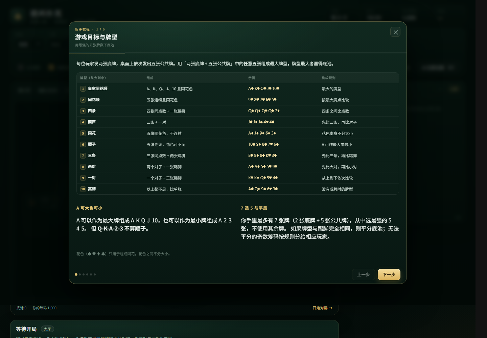
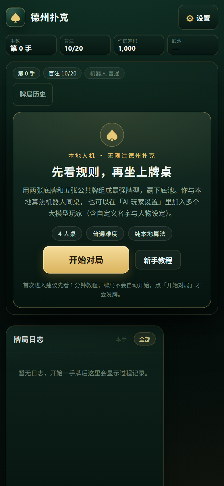
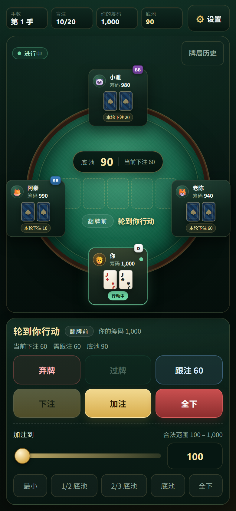
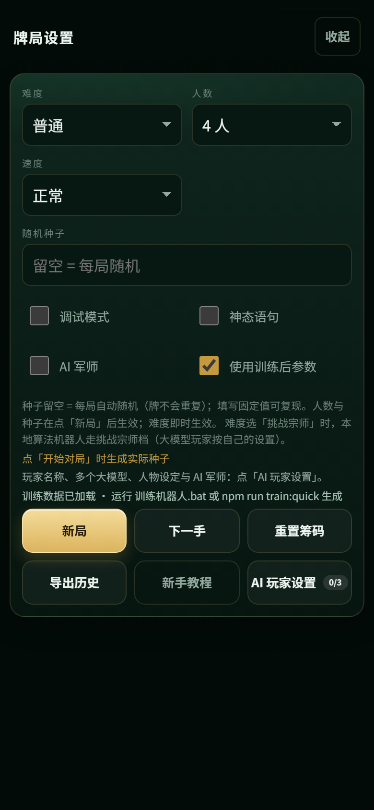

# 本地人机德州扑克（标准无限注）

一个**完全本地运行、零外部付费服务**的人机对战德州扑克项目：你 vs 最多 5 个机器人（本地算法 AI + 可选的 2 个本地大模型机器人），默认 4 人桌、盲注 10/20、起始筹码 1000。

- **新手引导**：第一次打开先看 6 页图文教程，进入大厅后点「开始对局」才发牌，不会一进来就蒙着开局。
- **规则引擎**：纯 TypeScript，覆盖标准无限注德州扑克的牌型、位置、单挑、下注轮、最小加注、short all-in、多层边池、摊牌分池。
- **本地算法 AI**：四档难度（入门 / 普通 / 困难 / 专家），由规则表 + 蒙特卡洛胜率驱动，不使用任何大模型 API。
- **挑战宗师（真 CFR+ 组件 + 诚实边界）**：单挑翻前用离线 CFR+ 蓝图（24 桶，SB+BB 双边）；转牌用**转+河联合 CFR+**（不需要价值函数），河牌用单街 CFR+ 子博弈，两者与启发式共用同一套范围；3 人以上用旧范围 + Pluribus 式多人谨慎。不再把挑战策略算完丢掉，也不再逐手回退专家动作。
- **五种策略族**：跟注站 / 松被动 / 紧凶 / 均衡 / 求解器；每族有连贯的翻前范围、下注尺度、诈唬与抓诈倾向，而不是同一策略换噪声。CFR+ 原语、真实胜率桶、按街范围信念、单挑翻前蓝图与转/河子博弈都在 `src/ai/solver/`，可用 `npm run bench` 复现配对基准与 95% CI。
- **本地大模型机器人（可选，不限 2 个）**：可接入任意 OpenAI 兼容服务（本地 Ollama / LM Studio / vLLM / llama.cpp，或外部接口），大模型玩家数量由人数决定（6 人桌最多 5 个）；每个玩家都能自定义**名称**与**人物设定**（性格 / 说话风格 / 打法倾向），可开关「神态语句」让模型附带短台词；调用失败自动回退本地算法，不卡牌局。
- **AI 军师（可选）**：给人类玩家自己的中文教练 / 聊天伙伴，可分析局势、复盘或闲聊，面板随时开关，只在按需点击时调用，省 token；看不到对手底牌。
- **玩家命名**：你自己、本地算法机器人、大模型玩家的名字都可以自由编写。
- **体验随机**：每局整桌随机分配机器人风格原型（紧凶 / 松凶 / 紧弱 / 跟注站 / 疯子 / 均衡），在难度允许范围内随机化下注尺度、慢玩 / 抢池、思考节奏，并可开关机器人台词；全部随机由种子派生、可复现。
- **真人化决策**：机器人有跨手公开统计（VPIP / PFR / 攻击性 / 面对下注弃牌率）、情绪（手感 / 上头）与按难度分级的真人式失误；困难 / 专家会读对手统计并选更优下注尺度，座位显示跨手画像，调试面板标注「读对手 / 手感 / 真人式失误」。
- **一键同步数据**：升级新版本时双击「一键同步数据」，自动找到旁边的旧版本并把训练参数、大模型经验库、训练报告同步过来（覆盖前自动备份到 `backup/`）；浏览器里的设置与大模型记忆同浏览器同端口自动沿用。
- **自博弈训练**：`npm run train` / 双击 `训练机器人.bat`（交互式：先问训练轮数 → 给出预计时间 → 确认后开始），同时训练规则引擎机器人（四档参数进化）与大模型机器人（few-shot 经验库 + 可选微调 SFT 数据集）。
- **手机 / 安卓 APK**：界面已完成手机适配（竖屏 / 横屏一屏完成「看牌桌 → 点按钮」、设置抽屉、≥46px 触摸目标、安全区、5/6 人桌座位自动缩放），并提供 `npm run apk` / `一键打包APK.bat` 一键打包**安卓安装包**（`apk/` 目录，release 签名，可直接安装）。
- 只使用虚拟筹码，不含真钱、充值、提现等任何功能。

## 界面预览

**大厅（首次进入先看教程，点「开始对局」才发牌）**


**新手教程（6 页：牌型表、位置顺序、操作、界面导览、AI 与大模型、训练）**



**手机端（390×844 竖屏）：大厅 / 牌桌 / 设置抽屉**

| 大厅 | 牌桌 | 设置抽屉 |
| --- | --- | --- |
|  |  |  |

手机端交互要点：顶部「设置」按钮把原本很高的设置栏收进抽屉；进行中的牌桌用整屏布局，牌桌 + 6 个动作按钮 + 下注滑块一屏放下；横屏自动切换为「左牌桌 / 右操作」两栏；按钮按下有缩放反馈，输入框 ≥16px 避免聚焦放大。

---

## 快速开始

### 环境要求

- Node.js **22.12+**（推荐 24 LTS）与 npm 10+；本项目在 Node.js 24 / npm 11 下验证。
- **没装 Node.js 也没关系**：双击「一键安装」时脚本会先检查本机；已经装了 Node.js 就直接跳过（不会重复安装），确实没有才会询问并自动下载官方 LTS 安装（Windows 弹 UAC 管理员授权；macOS 需输入 Mac 登录密码）。Linux 因发行版差异较大，只给出安装指引。
- 只有安装 npm 依赖和自动安装 Node.js 需要联网，游戏本身纯本地运行、不调用任何外部 API。
- 支持 Windows 10/11、macOS（Intel / Apple Silicon）与主流 Linux 桌面版；浏览器为 Edge / Chrome / Firefox 最新版。

### 方式一：一键配置（首次使用）

- **Windows**：双击 **`一键安装.bat`**；
- **macOS**：双击 **`一键安装.command`**（若提示“无法验证开发者”：右键 → 打开，或执行 `xattr -dr com.apple.quarantine .`）；
- **Linux / 终端**（macOS 也适用）：

```bash
bash 一键安装.sh            # 或：node scripts/setup.mjs
bash 一键安装.sh --agent    # 非交互，适合自动化
```

无论哪种方式都会：

- **先检查本机 Node.js**：已有就直接继续（不会重复安装）；没有才询问是否自动安装官方 LTS（`--install-node` 可免询问直接安装）；
- 加载项目后安装 npm 依赖 → 运行全部测试 → TypeScript 类型检查 + 生产构建自检（全部通过才算配置成功）；
- 完成后询问是否立即启动游戏（`Y` 直接开局）；
- 支持 `--agent`：不提问、不启动浏览器；无人值守模式下**不会**自动安装 Node.js（缺 Node 时退出并提示，避免擅自修改系统），适合交给 AI Agent / CI。

### 方式二：一键启动（日常使用）

- **Windows**：双击 **`启动德州扑克.bat`**；
- **macOS**：双击 **`启动德州扑克.command`**；
- **Linux**：`bash 启动德州扑克.sh`。

首次运行自动检查环境并安装依赖（需要联网，约 1-2 分钟）；若本机没有 Node.js，会先询问并自动安装官方 LTS（已有则直接跳过），然后自动启动本地服务并打开浏览器（http://localhost:5173）；再次运行时若检测到服务已在运行，只打开浏览器，不会重复启动；关闭终端窗口或按 Ctrl+C 停止服务。

### 方式三：命令行

```bash
cd <项目目录>        # 即包含 package.json 的目录，Windows / macOS / Linux 通用
npm install
npm run dev      # 启动开发服务器，浏览器打开 http://localhost:5173
npm test         # 运行全部单元 / 集成测试
npm run build    # TypeScript 类型检查 + 生产构建（输出 dist/）
```

### 方式四：手机 / 安卓 APK（推荐在手机上玩）

**A. 直接安装 APK（安卓手机）**

- 安装包就在项目的 **`apk/`** 目录里（当前 `apk/德州扑克-v0.21.0.apk`，约 3.4 MB，只使用虚拟筹码、默认不联网）。
- 传到手机：微信 / QQ 发给自己的「文件传输助手」→ 手机点开文件；或用 USB 数据线拷到手机 → 用文件管理器点击安装。
- 首次安装会提示「禁止安装未知应用」：在手机上允许文件管理器 / 浏览器的「安装未知应用」权限即可；支持 Android 6.0（API 23）及以上。
- **以后升级**：把新版本 APK 传到手机**直接覆盖安装**即可（同一签名，设置不丢）；卸载重装会清空应用里保存的大模型设置 / 记忆。
- 应用内「导出历史」无法像浏览器那样下载文件，会改为把牌局 JSON **复制到剪贴板**，粘贴到备忘录或聊天窗口保存。

**B. 自己重新打包 APK（改代码后）**

Windows 双击 **`一键打包APK.bat`**，或命令行：

```bash
npm run apk          # 生产签名 release APK → apk/德州扑克-v<版本号>.apk
npm run apk:debug    # debug 包（排查用）
```

构建要求（本机已预装，也可换用自己的路径）：

- **JDK 21+**：Capacitor 7 的安卓库按 Java 21 编译，只有 JDK 17 会报 `invalid source release: 21`；
- **Android SDK**：platform android-35 + build-tools 35（用 `ANDROID_HOME` 指定）；
- **Gradle 8.9**：首次构建自动下载，之后走本机缓存；
- 脚本自动执行 `npm run build` → `npx cap sync android` → 在纯 ASCII 构建目录（默认 `C:\AndroidToolchain\apk-build`）里 Gradle 打包 → 把 APK 复制回 `apk/`。**本项目路径含中文，AGP 不允许直接在 `D:\德州扑克\android` 构建，所以会先复制到 ASCII 目录**；可用 `HOLDEM_APK_BUILD_DIR` / `HOLDEM_JDK` / `HOLDEM_KEYSTORE_DIR` 覆盖默认路径；
- 签名：首次构建在 `C:\AndroidToolchain\keystore\local-holdem-release.jks` 生成发布密钥并在后续复用（保证覆盖安装），该文件不进仓库；也可以 `npx cap open android` 用 Android Studio 构建。

**C. 手机浏览器直接玩（不装 APK）**

- 电脑运行 `npm run dev -- --host 0.0.0.0`，手机和电脑连同一个 Wi-Fi，手机浏览器打开 `http://<电脑局域网 IP>:5173`（电脑需保持开机，仅局域网内可访问）；
- 也可以把 `dist/` 部署到任意静态服务器，用手机浏览器访问（游戏仍是纯前端运行）。

### 方式五：Windows 桌面版（.exe 安装包，给没有电脑基础的人）

安装包在项目的 **`release/`** 目录里（当前 `release/Holdem-Setup-0.19.0.exe`，约 **117 MB**）。

**安装步骤（三步，不需要任何电脑知识）**

1. 双击 `Holdem-Setup-0.19.0.exe`；
2. 安装自动完成——不弹路径选择、不需要管理员权限、不弹 UAC，装到当前用户目录；
3. 桌面和开始菜单会出现 **「德州扑克」** 图标，双击即可开玩。

**首次运行会被 Windows 拦一次**：安装包没有代码签名证书，SmartScreen 会提示「Windows 已保护你的电脑」。
点 **「更多信息」→「仍要运行」** 即可，只需一次。这是所有未签名软件的通病，不是文件有问题。

**它和浏览器版有什么区别**

- 独立窗口，不依赖浏览器、不用记网址、不会误关标签页；
- 仍然**完全离线**：本地起一个只监听 `127.0.0.1` 的服务提供页面，不访问外网；
- 设置、牌局历史都存在本机（Electron 的 localStorage），和浏览器版各自独立。

**卸载**：Windows「设置 → 应用 → 德州扑克 → 卸载」，或运行安装目录里的 `Uninstall 德州扑克.exe`。

**自己重新打包（改代码后）**

```bash
npm i                # 首次需要装 electron / electron-builder（约 250 MB）
npm run exe          # 生成 release/Holdem-Setup-<版本号>.exe
npm run exe:portable # 生成免安装的单文件 exe（不写注册表）
```

构建说明与坑（都已在 `electron-builder.yml` / `electron/main.cjs` 里处理）：

- 页面用**本地 HTTP 服务**提供，而不是 `file://`——Vite 产物是绝对路径（`/assets/...`），`file://` 下会白屏；
  这样也不用改 `vite.config.ts` 的 `base`（改了会影响安卓包）。
- `electronDist` 指向 `node_modules/electron/dist`，跳过 electron-builder 的在线下载——
  它的下载器（`got`）不读 `http_proxy`，在需要代理的网络下会**静默卡死**。
- `createDesktopShortcut: always`：默认值只在交互式安装时建桌面图标，静默安装（`/S`）会跳过。
- 冒烟自检（不需要人工看窗口）：`HOLDEM_SMOKE=1 HOLDEM_SMOKE_OUT=<文件> npx electron .`，
  会依次写入 `BOOT / READY / DIST_OK / SERVER_UP / DID_FINISH_LOAD / SMOKE_OK`。
  注意 Windows 的 GUI 子系统不把 stdout 接回父进程，所以只能看文件。
- 体积：Electron 运行时约 240 MB（解包后），NSIS 压缩后安装包 117 MB。这是 Electron 方案的固有成本。

### 方式六：Mac / Linux / 任意系统（单文件 HTML，双击即玩）

`.exe` **只能在 Windows 上跑**（里面是 win32 的 Electron 运行时 + NSIS 安装器，macOS 不认）。
macOS 的 `.app` 又必须在 Mac 上打包（electron-builder 会直接拒绝：`Build for macOS is supported only on macOS`）。
所以跨系统的形态是**一个 HTML 文件**：

```bash
npm run single     # → release/德州扑克.html（约 590 KB）
```

把 `release/德州扑克.html` 发给对方，**双击就能用默认浏览器打开玩**：

- 不需要安装 Node、不需要联网、不需要任何运行时；
- Windows / macOS / Linux 通用，Chrome / Edge / Safari / Firefox 都行；
- 所有 JS、CSS、图标都内联在这一个文件里，没有任何外部依赖；
- 设置和牌局历史存在浏览器的 localStorage 里（和浏览器版共享同一个来源，但和 exe 版各自独立）。

**已知差异（都验证过）**

| 项目 | 单文件 HTML | exe 桌面版 |
| --- | --- | --- |
| 依赖 | 无，双击即可 | 无（Electron 运行时已打包） |
| 存储 | 取决于浏览器对本地文件的策略；Safari 可能不保存设置 | 稳定保存 |
| 窗口 | 浏览器标签页 | 独立应用窗口 |
| 体积 | 590 KB | 117 MB |

`file://` 下的行为是实测过的，不是推断：用 Chromium 加载构建产物，页面文本长度 1687 字符、
与 HTTP 版**完全一致**，`localStorage` 可写。自检脚本：`npx electron scripts/smoke-single.cjs <html> <输出文件>`。

> 为什么不用 `file://` 直接开 `dist/index.html`：Vite 产物是绝对路径（`/assets/...`），
> `file://` 下会解析到磁盘根目录，直接白屏。单文件版靠「全部内联 + 相对路径」绕开这个问题。

### 从旧版本升级（之前已经装过旧版本）

**不需要重新跑一遍「一键安装」，也不需要在系统里重新安装 Node.js。** 分两种情况：

- **解压到新文件夹（推荐，可保留旧版本随时回退）**：
  1. 先关闭旧版本正在运行的服务（关闭旧终端窗口或按 Ctrl+C）。否则启动器检测到 5173 已有服务，只会打开旧版本的页面；
  2. 双击新版文件夹里的 **`启动德州扑克.bat`**（macOS 双击 `.command`，Linux 运行 `bash 启动德州扑克.sh`）；
  3. 启动器发现新文件夹里没有 `node_modules`，会**自动 `npm install`**（仅首次、需要联网，约 1–2 分钟），随后启动并打开浏览器。之后日常直接双击启动即可。
  - 想顺便做一次完整自检（安装依赖 + 全部测试 + 构建），可再双击一次「一键安装」：它是幂等的，检测到本机已有 Node 会直接跳过，不会重复安装系统软件。
- **覆盖解压到旧文件夹**：旧文件夹的 `node_modules` 会保留，通常直接双击「启动德州扑克」即可。如果新版本调整了依赖导致启动报模块缺失，再双击一次「一键安装」（或在该目录执行 `npm install`）即可。

**懒人方式：一键同步数据（推荐）**

- Windows：双击 **`一键同步数据.bat`**；macOS：双击 **`一键同步数据.command`**；Linux / 终端：`bash 一键同步数据.sh`（也可以用 `npm run sync:data`）。
- 脚本会先在**当前版本的上一级目录**里自动找其他 `local-holdem` 版本：只找到一个就直接用；找到多个会列出候选（最近更新时间 / 数据文件），回车默认选数据最新的，也可输入序号。
- **覆盖前自动备份**当前版本文件到 `backup/sync-<时间戳>/`（该目录不提交 git）；`--dry-run` 可先预览计划，`--list` 只列出候选。
- 旧版本不在旁边时手动指定：`node scripts/sync-data.mjs --from=../旧版本目录`。
- 同步的是项目文件夹里的数据（训练参数 / 经验库 / 训练报告 / SFT 数据集）；浏览器设置与大模型对局记忆**无需同步**；内存里的当前牌局与历史统计脚本搬不了，想留档请先在旧版本点「导出历史」。

**游玩数据会怎样？** 升级不会清空浏览器数据，但要分清三类数据的位置：

- **浏览器 localStorage（自动保留，无需备份）**：
  - 大模型玩家设置：名称、人物设定、Base URL、模型、API Key、温度 / 超时 / token 参数、启用状态；AI 军师配置；人类与本地机器人的自定义名称；
  - 大模型对局记忆（每个模型最多 80 条，总计 500 条）；
  - 「使用训练后参数」开关、教程已读标记。
  - 这些数据绑定「浏览器 + 地址」，保存在 `http://localhost:5173` 的 localStorage 里。保持同一浏览器、同一端口打开，换文件夹、覆盖安装、升级都不会丢；换端口（如 5174）、换浏览器或清理浏览器数据则读不到。
- **只在内存里（升级 / 刷新会丢）**：
  - 当前牌局（筹码、底池、未打完的这手）、牌局历史 / 回放数据、真人化跨手统计（VPIP / 情绪）；
  - 牌桌设置本身（难度、人数、速度、随机种子、调试模式、神态 / 军师开关）不持久化，每次打开页面都会恢复默认，升级后重新选一下即可；
  - AI 军师聊天记录。
- **想留档**：升级前点设置栏「导出历史」，会把当前配置 + 全部手牌历史导出成 JSON 下载到本地（目前只支持导出，没有「导入回游戏」；可用于归档或自己分析）。导出的文件在下载目录，不受升级影响。
- **自己训练出的参数**（如果你训练过）：`src/ai/data/learnedProfiles.json`、`src/ai/data/llm-experience.json` 与 `training/` 保存在**项目文件夹**里。解压到新文件夹时，新包自带的是发布时的训练产物；想保留自己的成果，升级前先备份，解压后拷到新目录对应位置。⚠️ 覆盖解压到旧文件夹时，新包里的同名文件会覆盖你训练过的文件，务必先备份。

> 每个版本的版本号见 `package.json` 的 `version` 字段（当前为 v0.15.x）。

### 交给 AI Agent 安装

在项目根目录执行一行命令即可完成全部配置与自检：

```bash
node scripts/setup.mjs --agent   # 成功时 exit 0，最后一行输出 SETUP_RESULT=OK
# macOS / Linux 也可以：bash 一键安装.sh --agent
# 无人值守模式默认不会自动安装 Node.js；确实需要时加：--install-node
```

> `--install-node`：检测不到 Node.js 时免询问直接安装（Windows 官方 MSI + UAC / macOS 官方 pkg + 密码）。本机已有 Node.js 时该参数不会产生任何安装动作。

更完整的 Agent 约束、修改指南与验收清单见 [AGENTS.md](AGENTS.md)。

其他命令：

```bash
npm run preview      # 预览生产构建
npm run test:watch   # 测试 watch 模式
npm run train:quick  # 快速自博弈训练（约 2 秒）
npm run train        # 全量自博弈训练（约 3 秒，默认 2 轮）
```

### 训练机器人（让 AI 越打越强）

- **Windows**：双击 **`训练机器人.bat`**：先询问训练轮数（1–10000，默认 2）→ 显示预计耗时与预计文件大小增量 → 输入 `Y` 确认后才开始；轮数 ≥ 2 自动启用多核并行；
- **macOS / Linux**：运行 `npm run train`（交互式 `.bat` 仅 Windows；命令行训练功能相同，参数用 `--rounds=N` / `--seed=xxx`）；
- 训练同时覆盖两类机器人：**规则引擎机器人**（四档参数进化）与**大模型机器人**（few-shot 经验库 + 可选微调 SFT 数据集）；
- 产物：`src/ai/data/learnedProfiles.json`、`src/ai/data/llm-experience.json`、`training/llm-sft-dataset.jsonl`、`training/REPORT.md`；
- 刷新页面后，设置栏会自动出现「使用训练后参数」开关（检测到训练数据时默认开启）。

---

## 推荐硬件配置

游戏本体是纯前端 + 本地算法，**不需要独立显卡**；只有可选的「本地大模型机器人」需要按模型规模准备显存 / 内存。

### 基础游戏（必需）

| 项目 | 最低配置 | 推荐配置 |
| --- | --- | --- |
| 操作系统 | Windows 10/11、macOS 12+、主流 Linux 桌面版 | — |
| CPU | 双核 | 4 核及以上 |
| 内存 | 4 GB | 8 GB 及以上 |
| 磁盘 | 300 MB（含 npm 依赖） | 1 GB 空闲（SSD 更佳） |
| 显卡 | 不需要，核显即可 | — |
| 浏览器 | Edge / Chrome / Firefox 最新版 | 桌面显示器，宽度 ≥ 1200px（1440×900 以上最佳） |
| Node.js | 22.12+ | 24 LTS |

- 牌桌与规则引擎开销很小，主要 CPU 开销来自本地算法 AI 的蒙特卡洛采样。
- 本机实测环境（Intel Core Ultra X7 358H，16 线程 / 32 GB 内存 / Windows 11 / Node 24）：困难档 8000 次采样约 45 ms/次，专家档 20000 次约 130 ms/次；4 核 CPU 也能流畅游玩，嫌慢可在设置栏把「速度」调成「快」。

### 训练机器人（可选）

| 项目 | 建议 |
| --- | --- |
| CPU | 4 核起步，8 核以上更快（脚本自动使用 min(CPU 核数, 16) 个 worker 并行） |
| 内存 | 8 GB；16 GB 更稳 |
| 磁盘 | 训练产物有固定上限，约 1 MB 量级，不会随轮数膨胀 |
| 显卡 | 不需要（训练是自博弈参数进化，不涉及 GPU） |

本机实测（16 线程）：10 轮约 2.3 秒（14,520 手）、100 轮约 13 秒（120,360 手）；同样的训练单线程约 10.8 秒 / 10 轮、约 120 秒 / 100 轮。核数越少耗时按比例增加，1–2 核机器跑 100 轮约需数分钟。

### 本地大模型机器人（可选，需自行部署）

需要在本机运行 Ollama / LM Studio / vLLM / llama.cpp server 之类的 OpenAI 兼容服务，模型规模决定硬件：

| 模型规模（Q4 量化） | 建议显存 / 统一内存 | 说明 |
| --- | --- | --- |
| 3B–4B | 4–6 GB | 最轻量，延迟低，适合核显 / 小显存 |
| 7B–8B | 6–8 GB | 推荐起点（如 qwen2.5:7b），质量与速度平衡 |
| 13B–14B | 10–12 GB | 决策质量更好 |
| 32B+ | 24 GB+ | 更强，但单步延迟明显变高 |

- 没有独立显卡也能纯 CPU 推理（7B Q4 约需 8 GB 内存），只是单步可能数秒；默认超时 60 秒，超时会自动回退本地算法，不会卡住牌局。
- Apple Silicon 统一内存可直接跑 7B–14B（16 GB 内存起步更从容）。
- 大模型是纯可选功能：不配置也能完整游玩，所有 AI 决策都由本地算法完成。

---

## 新手教程与大厅

- 首次访问（浏览器 localStorage 无教程标记）自动弹出教程；不自动发牌。
- 教程 6 页：游戏目标与牌型表 → 位置与行动顺序 → 操作说明 → 界面导览 → 四档 AI 与本地大模型 → 训练与开始。
- 关闭教程后停留在「大厅」：显示当前人数 / 难度 / 已启用的大模型座位；点「开始对局」才按当前设置创建牌桌并发牌。
- 设置栏「新手教程」按钮可随时重开教程。

---

## 玩法说明

- 打开页面 → 看教程 / 关教程 → 大厅点「开始对局」：默认 4 人（你 + 机器人）、盲注 10/20、起始筹码 1000。
- 人类操作：「弃牌 / 过牌 / 跟注 / 下注 / 加注 / 全下」；非法按钮自动禁用。
- 下注区：滑块 + 数字输入，快捷「最小 / 1/2 底池 / 2/3 底池 / 底池 / 全下」。
- 轮到人类行动或本手结束时，操作区会自动滚入视野（适配 1440×900 等常见桌面视口）。
- 每手结束点「下一手」；「新局」按当前设置重开一桌；「重置筹码」恢复所有人初始筹码并重新发牌。
- 设置项：难度、挑战宗师开关、人数（2–6）、人机速度（快/正常/慢）、随机种子、调试模式、AI 玩家设置（名称/大模型/军师）、神态语句、训练参数开关。
- 调试模式显示每个 AI 的决策依据（胜率、底池赔率、蒙特卡洛次数、大模型来源/耗时/原始响应）。
- 「牌局历史」查看已完成牌局的公共牌、各玩家底牌、底池结果与日志；「导出历史」保存 JSON。
- 随机种子留空（默认）→ 每次「新局 / 重置筹码」自动生成新种子，每局发牌都不同；填写固定种子 → 相同种子 + 相同动作序列可复现完全相同的牌局。

---

## 规则实现说明

### 牌与牌型

- 52 张牌，4 种花色不分大小；7 选 5 取最强组合。
- 牌型从大到小：皇家同花顺 > 同花顺 > 四条 > 葫芦 > 同花 > 顺子 > 三条 > 两对 > 一对 > 高牌。
- A 可作最大，也可作最小组成 A-2-3-4-5；**禁止** Q-K-A-2-3。
- 同牌型先比主牌点，再依次比踢脚；完全相同则平分底池。
- 牌型比较使用可排序整数分值（`src/game/handEvaluator.ts`），并通过「与暴力枚举 21 种 5 张组合结果一致」的随机测试交叉验证。

### 位置与行动顺序

- 按钮位每手顺时针轮转（跳过已淘汰 / 无筹码玩家）。
- 3 人及以上：按钮左为小盲、再左为大盲；翻牌前从大盲左第一位开始，翻牌后从按钮左第一位未弃牌玩家开始。
- 单挑（2 人）：按钮兼小盲，翻牌前按钮先行动，翻牌后大盲先行动（单独实现并测试）。
- 支持 2–6 人可配置，默认 4 人。

### 发牌

- Fisher-Yates 洗牌；随机源为字符串种子派生的 mulberry32 PRNG，可复现。
- 从按钮左边开始顺时针、两轮，每人 2 张底牌。
- 翻牌、转牌、河牌前各烧一张牌（burn card），烧牌不公开。

### 下注轮

- 四条街：翻牌前、翻牌、转牌、河牌。
- 动作：弃牌、过牌、下注、跟注、加注、全下；无限注，下注上限为剩余筹码。
- 翻牌前大盲 option：无人加注时，轮到大盲可过牌或加注。
- 下注轮结束条件：所有未弃牌且未全下玩家已行动且投入相同；或只剩一个未全下玩家且已跟平。
- 只剩一名未弃牌玩家：立即结束，不摊牌，直接赢得底池。
- 所有剩余玩家全下：一次性发完剩余公共牌并摊牌，不再下注。
- 未被跟注的多余下注退回。

### 最小加注与 short all-in

- 翻牌前初始下注额 = 大盲；最小加注增量 = 上一次完整加注的增量。
- 翻牌后最小下注额 = 大盲；最小加注增量同上。
- 示例：当前下注 100，有人加注到 250（增量 150），下一次最小加注到 400。
- **short all-in 策略（README 与代码保持一致）**：
  - 不足最小加注的全下，**不重新开放**已行动玩家的加注权；已行动玩家面对它只能跟注或弃牌。
  - 尚未行动的玩家仍可正常加注到完整最小额（当前下注 + 上一次完整加注增量）。
  - 多个 short all-in 累计达到一次完整加注额时，按 TDA 累积规则重新开放已行动玩家的加注权。
  - **不采用** TDA 的「50% 补充规则」：全下达到最小加注额一半时不会被补足为完整加注。
  - 当短全下金额小于大盲时（如翻牌后全下 5、大盲 20），最小加注按「补足到完整大盲」处理。
- 盲注不足时可以全下（如大盲只剩 5 筹码）；该玩家状态为全下，实际投入参与边池层级计算。

### 边池与分池

- 独立模块 `src/game/pot.ts`，未简化成单池。
- 主池 = 最小全下筹码 × 参与人数；边池依次用「次小投入 − 前一层级」× 对应参与人数计算。
- 弃牌玩家的筹码留在底池中，但无资格赢取任何底池；每个玩家只能赢取自己投入达到的层级。
- 未被跟注的多余下注退回。
- 平分时奇数筹码给「按钮左边第一个赢家」（按顺时针顺序逐个分配）。
- 每个底池独立比较牌型、独立分配；一个玩家可同时赢得主池与部分边池。

### 摊牌与日志

- 摊牌显示所有未弃牌玩家底牌，高亮赢家与牌型（最佳 5 张）。
- 所有动作合法性由引擎校验：非法动作抛出带中文说明的 `IllegalActionError`，UI 同时禁用非法按钮。
- 中文日志覆盖：开局/盲注/发牌、每条街公共牌、每个动作、摊牌牌型、底池分配、未跟注退回、赢家与奇数筹码。
- 摊牌前日志与 AI 视图中不出现任何对手底牌。

---

## 本地算法 AI（四档难度 + 挑战宗师模式）

四档不只是同一逻辑换参数，而是不同算法复杂度与风格：

| 难度 | 翻牌前 | 翻牌后 | 蒙特卡洛次数 | 风格 |
| --- | --- | --- | --- | --- |
| 入门 | 固定起手牌分级表，不看位置 | 只看牌型强度与跟注成本 | 不使用 | 松被动：跟注多、加注少、几乎不诈唬、允许小概率随机失误 |
| 普通 | 起手牌范围表 + 位置调整 | 手牌强度阈值 + 底池赔率 | 不使用（启发式） | 中等松紧：偶尔诈唬，下注尺度以 1/2 底池为主 |
| 困难 | 范围表 + 位置 + 混合频率 | 蒙特卡洛胜率 + 底池赔率 + 位置 | 8000 | 会半诈唬，混合 1/2、2/3、底池尺度 |
| 专家 | 更紧的范围 + 位置 + 3-bet 随机化 | 蒙特卡洛 + 行动历史范围收窄 + SPR/多街计划 | 20000 | 价值/诈唬更平衡，尺度更多样（含少量超额），加注率最高 |

实测翻牌前行为（300 个随机 3–6 人桌、当前行动者，`npm test` 中也有对应断言）：

| 难度 | 弃牌率 | 跟注率 | 加注率 |
| --- | ---: | ---: | ---: |
| 入门 | 15.3% | 84.3% | 0.3% |
| 普通 | 45.7% | 25.7% | 28.7% |
| 困难 | 50.7% | 16.0% | 33.3% |
| 专家 | 53.7% | 4.7% | 41.7% |

- 实现：`src/ai/difficulty.ts`（档位）、`rangeModel.ts`（起手牌/位置/听牌）、`equity.ts`（蒙特卡洛）、`aiPlayer.ts`（决策）。
- 决策目标 < 2 秒；困难/专家异步分片，每约 2000 次迭代让出主线程，UI 不卡。
- 实测（本机 Node.js 24，默认迭代）：困难 8000 次约 45ms/次；专家 20000 次约 130ms/次。

### 挑战宗师模式（真 CFR+ 组件 + 诚实的强度边界）

难度选择 **「挑战宗师」** 后，本地算法机器人按**静态条件**选择引擎，不再做逐手 EV 回退：

| 场景 | 实际启用的引擎 | 说明 |
| --- | --- | --- |
| 单挑 · 翻前 | 离线 CFR+ 蓝图（24 桶，SB + BB 双边） | BB 蓝图配对消融 **+16.5 BB/100（CI [5.1, 28]，显著）**；SB 中性 |
| 单挑 · 翻牌 | 专家启发式 + 蓝图推出的策略一致范围 | 翻牌是唯一还没有求解器的一街 |
| 单挑 · 转牌 | **转+河联合 CFR+**（`subgameTurn.ts`，中位 181ms） | 终点是摊牌，不需要价值函数；8 万手定论：中性（−2.1，CI [−7.6, 3.5]） |
| 单挑 · 河牌 | 全范围 vanilla CFR+ 子博弈（**已启用**，只在面对下注时触发） | 与转河求解共用同一套范围；同属上面那次 8 万手中性测量 |
| 3 人 | 挑战启发式 + 多人谨慎 + 旧范围 | 不把单挑解硬套到多人 |
| 4–6 人 | 专家启发式 + 多人谨慎 | 明确不是单挑 GTO；调试标记 `challenge-multiway` |

- **翻前蓝图（Libratus blueprint 的缩小版，已启用，SB 与 BB 双边）**：169 类起手牌按**真实胜率**（对随机手牌蒙特卡洛）分成 **24 个桶**（原 10 桶太粗），再在「SB fold/raise 2.5/3.5；BB check/3-bet/all-in」的抽象树上跑 CFR+。离线产物 `src/ai/data/preflop-blueprint.json`，6 万次迭代后**抽象游戏内可利用度 0.0176 BB/手**。

  **这轮修掉了三个真 bug（都不是调参问题）：**

  | bug | 现象 | 根因 |
  | --- | --- | --- |
  | 跛入后弃牌亏损写成 `-0.5` | SB 99% 跛入 | SB 已投 1BB，弃牌应亏 1BB；写 -0.5 等于把跛入成本砍半 |
  | 分桶按「攒够 target 进位」 | 24 桶时最后一个桶为空，策略表出现 `undefined` 起手牌 | 每桶超调累积，末桶分不到类；改为按累计权重的分位切桶 |
  | 最佳回应按 (SB桶, BB桶) 组合分别取 max | 可利用度卡在 **3.3 BB/手**，加迭代也不降 | 等于让回应方**看穿对手手牌**；真 BR 只能看自己的桶，对手桶要按 reach 加权求和后再取 max |

  修完后 SB 策略正常：**弃 8.4% / 加注 54.7%**（禁用跛入版），BB 对 2.5x 开池**弃 21.7% / 跟 59.1% / 3-bet 13.3%**。

  **叶节点估值加了权益实现率**（`equity` 换成位置相关的兑现份额，零和归一化）：有位置 1.10、无位置 0.90，随 SPR 衰减（全下后没有位置可言）。实测我们引擎的兑现率是 **IP 0.985 / OOP 1.009**——也就是说当前翻后打法几乎不吃位置红利；蓝图用 1.10/0.90 是刻意不把这个缺陷固化进去。

- **翻后范围改为「蓝图动作频率推出的策略一致先验」**：对手拿到某手牌时走这条翻前线的概率 = 沿途每个动作在其信息集策略里的概率之积（ReBeL belief 的简化版），替换掉旧的「翻前强度 + 加注次数」启发式。单挑生效，多人回退旧模型。

- **转牌 + 河牌联合求解（已启用，不需要价值函数）**：`src/ai/solver/subgameTurn.ts`。
  旧版转牌如果按单街解，树的叶子会把「转牌 check-check」当成立即摊牌——但真实游戏后面还有一条河牌街，
  这个建模错误让转牌求解一直是负贡献。联合求解把树一直展开到河牌摊牌，**终点就是真实收益**，
  因此不需要神经网络价值函数——这是深度受限求解里唯一不需要近似的情形。

  - 河牌抽象：46 张河牌按「成对 / 成花 / 高张」打分后等分成 3 个桶，每桶用桶内**所有牌**的摊牌矩阵取平均
    （不是用一张代表牌）。46 张全算一遍约 19ms（摊牌判定实测 0.73µs/次）。
  - 成本：20 手 / 3 个河牌桶 / 160 次迭代，**中位 181ms、p90 227ms**（本机）；带 400ms 时间预算兜底。
  - 策略合理且收敛：99 面对下注跟注、72o 弃牌、KK 跟注、99 在被过牌后满池下注；100 次与 800 次迭代策略一致。
  - **配对消融（定论，8 万手）**：整套求解器（转河 + 河牌）相对纯启发式
    **−2.1 BB/100，95% CI [−7.6, 3.5]**。这是第一次有足够分辨力（±5.6 BB/100）的测量，
    结论是**中性**——求解器没有带来可测量的强度提升。
    保留它不是因为「变强了」，而是因为：①它数学上严格更正确（消除了单街建模错误）；
    ②对真人时均衡策略的可利用性低于启发式，这一点无法用「打自己」的基准测出来；
    ③成本在思考动画预算内（转牌中位 181ms）。若要更快响应，把
    `ENABLE_TURN_RIVER_SOLVER` / `ENABLE_RIVER_SOLVER` 置 false 即可，强度不会变差。

- **河牌单街 CFR+ 子博弈（已启用，只在面对下注时触发）**：`src/ai/solver/subgame.ts` 使用**双边范围 + 全树遍历、全部 combo 同时更新的 vanilla CFR+**（不是采样版），树包含 check / bet 33% / 50% / 100% 与 fold / call / raise。按 DeepStack 附录 S3 与 Depth-Limited 附录 B 实现「平均策略跳过前 50% 迭代」与「前 30 轮 √T/(√T+1) 折减遗憾」；400 次迭代即收敛。
- **按街范围信念（已实现、默认不用于启发式）**：`src/ai/solver/ranges.ts` 做「翻前先验 × 每条街动作似然 × 牌面纹理 × 牌张移除」。但 10k 手分层基准显示，在当前似然参数下它比旧的「翻前强度 + 行动计数」更差（挑战用新范围、专家用旧范围时 -30.7 BB/100）；因此启发式继续用旧模型，新模型留给求解器和后续校准。
- **求解器与启发式共用同一套范围**：新增 `rangeFromWeight()`，把启发式用的 `(first, second) => weight`
  闭包展开成求解器要的 `Range`，两条路径（转河求解、河牌求解）都吃同一份权重。
  之前求解器内部另建按街范围，是「转牌按均衡打、河牌按启发式打」割裂的根源之一。
- **河牌求解器已启用**（此前默认关闭）：转牌解假设河牌按均衡打，若河牌改走启发式就自相矛盾。
  现在两条街都由求解器接管（河牌仍只在「面对下注」时触发，这是之前配对测量里更好的一档）。

- **多人谨慎（Pluribus 启发）**：多人底池按对手数打折诈唬的弃牌收益（2 人 0.72 / 3 人 0.5 / 4+ 人 0.35）。
- **宗师原型 / 读计时 / 读下注**：保留，并影响挑战分支的 profile / required equity / 下注尺度。
- **公平性**：只使用 PlayerView 公开信息；不读取对手底牌；`view.seed` 已加盐，不能从视图种子逆推牌堆。
- 实现：`src/ai/solver/cfr.ts`（CFR+ 原语）、`preflop.ts`（蓝图）、`subgame.ts`（河牌单街）、`subgameTurn.ts`（转+河联合）、`ranges.ts`（按街范围）、`abstraction.ts`（真实胜率桶 / 牌面纹理 / 组合）、`blueprint.ts`（加载）；离线生成 `npm run gto:equity` / `npm run gto:blueprint`。

**最终基准（`npm run bench`，配对发牌，95% CI）**：

| 对手 | 挑战 AI BB/100 | 95% CI | 样本 | 说明 |
| --- | ---: | --- | ---: | --- |
| 专家档 | **+16.7** | [4.2, 29.2] | 40,000 手 | 统计显著为正；另一组 60,000 手为 +7.6 [−2.9, 18.1] |
| 永远跟注站 | +608.3 | [560.1, 656.4] | 4,000 手 | 价值下注碾压 |
| 永远弃牌 | +55.9 | [54.4, 57.3] | 4,000 手 | 仍低于理论 ~+75 |
| 极紧弱 | +68.3 | [65.8, 70.9] | 4,000 手 | — |
| 永远全下 | +264.6 | [190.3, 338.9] | 4,000 手 | 能赢疯子，但不是神话 |

> **挑战档的真实定位**：对跟注站 / 疯子 / 极紧弱这类典型业余玩家是碾压级（+264 ~ +608 BB/100），
> 对「专家档」这个启发式基线是**正收益**（40,000 手 +16.7 [4.2, 29.2]；另一组 60,000 手 +7.6 [−2.9, 18.1]）。
> 但要注意：**跨 seed 集的波动约 ±10 BB/100**，比单次报告的置信区间更宽——同一配置在不同 seed 前缀上可以差出 20+。
> 所以「挑战档比专家档强多少」只能给区间（约 +5 ~ +20），不能给精确值。
> 一次 30,000 手的同 seed A/B 曾给出「开启求解器 +33.0、关闭 +6.0」，但随后 8 万手的高功效配对消融把求解器的真实贡献定在 −2.1（CI [−7.6, 3.5]）——**那次 +33 是离群值**。这里按定论数字修正。

### 测量功效：为什么“+21.7 BB/100”这类数字不可信

这个项目的基准方差极大：单手标准差约 **9.45 BB/手**（50BB 筹码深度下大量全下）。
在 95% 置信、双侧检验下，要分辨 10 BB/100 的差异需要约 **25 万手/组**；分辨 40 BB/100 需要约 1.6 万手/组。

公式：`CI 半宽 = 1.96 × sd × 100 / √手数`（sd ≈ 9 BB/手）。
反推：`要分辨 X BB/100 需要 ≈ (1.96 × 9 × 100 / X)²` 手。

| 每组手数 | 95% CI 半宽（BB/100） |
| ---: | ---: |
| 4,000 | ±28 |
| 10,000 | ±18 |
| 60,000 | ±7.2 |
| 250,000 | ±3.5 |

`npm run bench` 现在会直接打印「本次 95% 分辨率」和「要分辨 10 BB/100 约需多少手」，
避免再把噪声当结论。按 sd≈9 计算，分辨 10 BB/100 约需 **5.4 万手**，分辨 5 BB/100 约需 **21 万手**。

**这意味着本项目历史上绝大多数“±10 BB/100 的改进”都在噪声内**，包括：
`pickChallengeDecision` 回退前后的对比、河牌求解器的几次消融、SB 开池宽度的网格搜索
（0.45 配对消融 +23.6、0.55 +31.8，但独立跑分别是 +8.5 和 +0.7——两组设计互相矛盾）。
只有像「挑战 vs 专家 60,000 手」这种量级的结论才站得住。

### 要真正接近「不可战胜」还差什么（含本轮实测结论）

Libratus 与 Pluribus 的强度来自**离线解一个抽象游戏 → 运行时查表 + 安全子博弈求解**。
本轮把第一层（翻前蓝图）真正修好并实测，得到一个反直觉但很重要的结论：

> **粗糙的 GTO 抽象，配上不 GTO 的翻后，会比启发式更差。**

证据：修完三个 bug 后，SB 蓝图（含 36.8% 跛入）让胜率 **−12.4 BB/100**；把跛入从树里去掉后变成 **+0.1**（中性）。
原因是蓝图假设「跛入后能用位置把胜率兑现出来」，而我们的翻后是启发式，兑现不了。
同理，BB 蓝图（防守范围，不依赖翻后主动打法）是 **+16.5 BB/100，CI [5.1, 28]，统计显著**。

**这直接决定了后续顺序**：不能先堆更细的翻后蓝图，因为翻后蓝图恰恰最依赖「翻后打法本身接近均衡」。

| 层 | 现状 | 结论 |
| --- | --- | --- |
| 翻前蓝图 | ✅ 24 桶、双边、可利用度 0.0176 BB/手 | 已完成；BB 显著正贡献，SB 中性 |
| 翻后范围 | ✅ 蓝图动作频率推出的策略一致先验 | 已完成；−1.4（CI [−10.6, 7.7]）中性，理论更正确 |
| CFR-D gadget | ⏸ 未启用 | Depth-Limited 论文附录明确：**某一轮第一次求解用 unsafe 是正确做法**，之后才用 safe nested。我们每条街只解一次，属于「第一次」，加 gadget 反而无锚点 |
| 转牌求解 | ⏸ 未启用 | 需要河牌价值函数（DeepStack 用神经网络）。用启发式当价值函数等于把启发式偏差写进解里，风险大于收益 |
| 翻牌/转牌/河牌蓝图 | ❌ 不建议在当前架构下做 | 上面的证据表明：没有匹配的翻后求解器，粗抽象会**放大**而不是缩小差距 |

**真正要走到「不可战胜」，必须先有翻后求解器，再有翻后蓝图**——这两件事必须一起做，
而翻后求解器需要价值网络（DeepStack）或超算级抽象树（Libratus）。这是另一个量级的工程，
不是在本项目现有架构上继续加模块能达成的。

### 策略族（不同水平的真人）

五档不再只是同一套逻辑换阈值，而是五种有连贯范围与翻后倾向的策略族：

| 难度 | 策略族 | 翻前 | 翻后 |
| --- | --- | --- | --- |
| 入门 | 跟注站 | 入池很宽、极少主动加注 | 爱看摊牌、诈唬很少、`callMargin` 为负（用比底池赔率更差的牌跟注） |
| 普通 | 松被动 | 位置感知、偏宽 | 半池为主、偶尔诈唬、面对压力偏弃牌 |
| 困难 | 紧凶 | 较紧、混合加注 | 蒙特卡洛胜率、听牌半诈唬、多尺度 |
| 专家 | 均衡 | 更紧、3-bet 随机化 | 按街范围收窄、SPR / 多街计划、价值/诈唬更平衡 |
| 挑战宗师 | 求解器 | 单挑 24 桶蓝图（双边） | 单挑转+河 CFR+；翻牌与多人仍是启发式 |

### 剥削层：把「读人」从文案变成阈值

`src/ai/exploit.ts`。翻后启发式的三个阈值（价值线 / 诈唬率 / 跟注线）此前全是**常量**，
对「跟注站」和「弃牌站」用同一套数字——这是最容易被人类针对的地方。

现在它们由**公开统计**驱动，每个数字都有可追溯的依据：

| 调整 | 依据 |
| --- | --- |
| 诈唬率随下注尺度缩放 | 均衡 α = bet/(pot+2bet)。满池 α=1/3、半池 1/4、三分之一池 1/5。旧实现固定 0.18，与尺度脱钩：大注诈唬不足（被过度弃牌利用）、小注诈唬过多（被过度跟注利用） |
| 对跟注站把价值线压到 **0.5** | 对手从不弃牌时，下注的 EV 盈亏平衡点就是胜率 0.5。旧实现固定 0.6，等于把 40% 的盈利下注改成过牌 |
| 对跟注站停止诈唬、尺度放大 | 他不弃牌，诈唬的弃牌收益恒为 0；同时他的跟注范围不会缩，做大底池 |
| 对弃牌过多的对手提高诈唬率、尺度缩小 | 弃牌率与尺度无关时，用小尺度换同样的弃牌率，风险更小 |
| 跟注线向底池赔率收敛 | 旧实现固定 `potOdds + callMargin`（挑战档 +0.04），是**系统性防守不足**，正好被爱诈唬的对手利用。现在 `callMargin × (1 − closeness)`，挑战档只剩 +0.003 |
| 高攻击对手降低跟注线 | 他们下注频繁 ⇒ 下注范围偏弱 ⇒ 多抓诈 |
| 高加注频率压制诈唬 | 诈唬的 EV 里包含「被加注后弃牌」的损失，弃牌率正常也不代表可以诈唬 |
| 价值下注频率 0.7 → 0.95 | 0.7 的随机跳过是为了不可预测；对跟注站跳过价值注是直接丢 EV |
| 翻前：对弃牌 55%+ 的对手，按钮用任意两张开池 | 弃掉任何两张牌等于放弃 1.5BB 的底池（净赢 1BB）。蓝图约 8% 的 SB 弃牌率假设对手会正常防守 |
| 翻前：对**爱再加注**的对手（攻击性 ≥2.5，如每手全下），强度 <65% 的手牌改跛入 | 加注后会被再加注：用一手不会跟再加注的牌加注，亏 3.2BB；跛入只亏 1BB |
| 翻前：对**爱跟不爱弃**的对手（跟注站），强度 <35% 的手牌改跛入 | 他不会反打，弱牌加注只是放大波动；门槛因此低得多 |

三条防止「读错人比不读更糟」的约束：

1. **样本量门槛**：`archetype = unknown` 时（平均不足 2 手）完全退回 GTO 基准，不做任何偏离。
2. **难度门槛**：采纳权重 `w = confidence × closeness`。入门档（closeness 0.02）几乎不调整，
   挑战档（0.92）才把统计用到底——低难度本来就该「不会读人」。
3. **硬边界**：跟注线最多偏离底池赔率 −0.15 / +0.20，避免统计噪声把阈值推到荒谬区间。

#### 顺带修掉的一个统计 bug（它让上面一半逻辑失效）

`stateMachine.ts` 的动作计数里，`allin` **完全没有被计入** `bets` / `raises` / `calls`。
后果：一个「每手全下」的对手，`aggression = (bets+raises)/calls = 0/1 = 0`，
被系统判定为**全场最被动**的人——针对它的剥削逻辑（提高诈唬、降低跟注线、跛入替代加注）全部反向或失效。

修复：全下按是否抬高当前下注额，分别计入 `raises` 或 `calls`。修完后同一个对手的 `aggression` 从 0 变成 5（上限），
按钮位开池率从 60% 降到 33.7%、跛入从 16.3% 升到 42.7%。

验证方式不是 BB/100（分辨率只有 ±5.6），而是**零噪声的数学断言**（`src/tests/exploit.test.ts`，16 个用例）：
MDF / α 公式、诈唬率随尺度单调、各类型的调整方向、边界、采纳权重，以及「动作真的变了」的接线测试。
另外新增 `npm run audit:exploit`：对**固定策略**对手做连续牌局审计（统计会累积、位置自然轮转），
配对差值的 95% CI 半宽在 **±4～±8 BB/100**（便宜对手，500 手/臂）——比「打自己」精确一个量级。

#### 实测（`npm run audit:exploit`，500 手/臂，同 seed 配对，**筹码 1000 / 大盲 20 = 50BB**）

| 对手 | 剥削层关 | 剥削层开 | 配对差值（95% CI） | 说明 |
| --- | ---: | ---: | --- | --- |
| 弃牌站（见注就弃） | +57.3 | **+75.0** | **+17.7** [13.5, 21.9] | 正好达到理论最大值（每手净赢 0.75BB：按钮 1BB / 大盲 0.5BB） |
| 紧弱（只跟小注） | +65.2 | +86.4 | **+21.2** [13.0, 29.4] | |
| 极紧（>1BB 就弃） | +73.8 | +95.6 | **+21.8** [14.4, 29.2] | |
| 跟注站（从不弃牌） | +260.1 | **+530.1** | **+270.0** [108.1, 431.9] | 转牌下注率 8% → 52% |
| 疯鱼（宽 + 凶 + 不弃） | +514.2 | **+889.9** | **+375.7** [204.6, 546.8] | 几乎不弃牌，价值线压到 0.5 |
| 永远全下 | −34.1 | −82.9 | −48.8 [−173.1, 75.5] | **测不出来**，见下 |

五类对手的配对差值全部统计显著为正。同一 seed 重跑，结果**逐位一致**——对手策略是确定性的，
整个测量完全可复现，不存在「换个 seed 结论就变」的问题。

**「永远全下」为什么测不出来，以及为什么这不是漏洞**：审计用的筹码是 1000、大盲 20，即 **50BB** 深度
（表格里所有数字都是这个深度；脚本的 `STACK` / `BB` 可覆盖）。这个对手每手都把 50BB 推上来，
单手标准差约 **39 BB**，分辨 20 BB/100 需要 **14 万手**。而理论上最优打法对「每手全下」的
总期望本来就只有约 **+12 BB/100**——BB 位置约 +365（用约 50% 的范围跟注，平均 57% 胜率：
`0.5 × 8.3BB + 0.5 × (−1BB) = +3.65BB/手`），SB 位置约 −340（弃牌只亏 0.5BB，但加注后弃牌亏 3BB），
两者相抵。所以这个对手在 50BB 下**本来就不该被大幅惩罚**，测量结果落在 0 附近是预期行为。
对这部分改用零噪声断言验证：AA / KK 面对全下必须跟注，72o / 32o 必须弃牌（`exploit.test.ts`）。

### 翻前决策的两个致命 bug（v0.20.0 修复）

这两个 bug 是被一局真实牌谱打出来的：6 人桌只剩两家有筹码，对手 126BB 全下，
机器人拿 **J9o** 跟了 2430，输掉 5040 的底池。

#### bug 1：起手牌强度按 Chen 公式排序，导致「被压制的牌反而更强」

`rangeModel.ts` 把 169 个起手牌分类**按 Chen 公式排序**，再把累计组合占比当作「强度百分位」。
Chen 是可玩性启发式，会给连张加分，于是：

| 手牌 | Chen | 旧「强度」 | 真实胜率 | 真实百分位 |
|---|---:|---:|---:|---:|
| J9o | 6 | **0.787** | 52.9% | 0.615 |
| Q9o | 5 | **0.647** | 55.2% | 0.686 |

**Q9o 完全压制 J9o（Q>J，9=9），却被排在了后面。** 项目里本来就有真实胜率表
（`data/preflop-equity.json`，当初为求解器生成），只是翻前决策没接。现在两边统一，
J9o → 0.615、Q9o → 0.686，压制关系恢复。

#### bug 2：翻前跟注完全不看要跟多少

`decidePreflop` 的跟注条件只有 `strength >= 入池线`：

```ts
} else if (strength >= thresholds.play) {
  action = legal.canCall ? { type: 'call' } : ...
```

**`ctx.potOdds` 在翻前一次都没被读过。** 面对「加注到 40」和「全下 2520」用的是**同一个跟注范围**。

修复：面对占自己筹码 ≥25% 的加注时，改用真正的数学判定（`src/ai/preflopCall.ts`）：

1. 用「要投入多少筹码 + 对手 PFR + 加注轮次」估计对手加注范围有多窄（前百分之几）；
2. 蒙特卡洛算**我方手牌对那个范围的胜率**（200 次样本，约 1ms）；
3. 和底池赔率比，够就跟、不够就弃。

同一局面的实测输出：

```
起手牌 J9o，要跟 2430（占自己筹码 96%），估计对手范围前 7%，
我方对该范围胜率 32.5%，底池赔率需要 48.2% → 弃牌
```

J9o 对全下范围只有 **32.5%**，而跟注需要 **48.2%**——这手牌每跟一次约亏 **790 筹码**。
现在会弃牌；AA 在同一局面仍然跟注。

回归测试见 `src/tests/preflopCall.test.ts`（11 个用例），锁死三件事：
压制关系必须正确、加注越大估计范围越窄、面对全下 J9o 必弃 / AA 必跟。

> 诚实说明：这两个 bug 修完只做了**针对性验证**（同一局面复现 + 单测），
> 没有重跑大样本基准。也就是说「这个具体错误不会再犯」是确定的，
> 「整体强了多少 BB/100」这次没有测。

### 翻前 EV 引擎（v0.21.0，替换掉整套阈值表）

v0.20 只修了「面对大幅加注」那一个分支，但病根更深：整套翻前是**三层阈值表**
（入池线 / 加注线 / 3-bet 线）+ 一堆随机混合系数。它有三个结构性缺陷，调参修不掉：

1. 跟注额不参与决策（`ctx.potOdds` 在翻前一次都没被读过）；
2. 位置只改阈值高低，不改「这手牌在这个位置值多少钱」；
3. 加注只看牌力、不看弃牌率——对手从不弃牌时加注毫无意义。

现在每个合法动作都算期望值，取最大（`src/ai/preflopEv.ts`）：

```
EV(弃牌) = 0
EV(过牌) = 权益 × 底池 × 权益实现率
EV(跟注) = 权益 × (底池 + 跟注额) × 实现率 − 跟注额 − 风险溢价
EV(加注) = 弃牌率 × 底池
         + (1 − 弃牌率 − 被再加注率) × [对跟注范围权益 × (底池 + 2×投入) × 实现率 − 投入]
         + 被再加注率 × (−投入)
         − 风险溢价
```

**四个参数都写明依据，并且是对着公开 GTO 范围校准的：**

| 参数 | 做法 |
| --- | --- |
| 对手范围（前百分之几） | 由「要投入多少 / 对手 PFR / 加注轮次」估计（`estimateRaiserRange`） |
| 权益实现率 | 位置（IP 1.08 / OOP 0.92）× 人数衰减 × **牌型可玩性**（同花 +0.12、连张 +0.06、大间隔杂色 −0.24） |
| 弃牌率 | 直接估「所有人弃牌」，**不是**「单人弃牌率 ^ 人数」（后者把 6 人桌开池算成 0.62⁵ = 8.6%） |
| 被再加注率 | 开池 10% / 3-bet 15% / 4-bet 5%——**漏掉这一项会让模型认为「3-bet 任何两张都赚」** |
| 风险溢价 | 投入的 6%。权益是 200 次蒙特卡洛的估计（标准误 3.5%），在 0 EV 附近做决策等于在噪声上做决策 |

**校准结果**（`npm run sweep:preflop`，扫 169 个起手牌分类）：

| 场景 | 加注 | 跟注 | 弃牌 | 对照 GTO |
| --- | ---: | ---: | ---: | --- |
| 6 人桌 UTG 开池 | **19%** | —（开池不许跛入） | 81% | UTG 约 15–18% |
| 6 人桌 面对 3BB 开池 | 7% | 18% | 76% | 中位约 15–20% |
| 单挑 面对 126BB 全下 | — | **5%** | 95% | 约 4–6% |

**难度 = 决策噪声**：挑战档 8 筹码（≈0.4BB，几乎不影响正确决策），入门档 180 筹码（≈9BB，会经常打错）。
这比「换一套阈值」更能体现「不同水平的真人」。

**开池阶段禁止跛入**（除非前面已经有人跛入，或单挑 SB）：跛入在纯 EV 上看着便宜（3:1 赔率），
但会招来加注且翻后无位置。实测不禁止时，引擎在 6 人桌 UTG 跛入 35%——这是明显漏洞。

### 论文与开源项目：实际读了什么、改了什么

这一节记录的是**实际下载并逐页读过**的内容，不是只看了标题。Science 正刊（Libratus / Pluribus）是付费墙，
直接下载返回 403，所以改读了这两套算法背后的原始论文；下面的引文与行号都来自本地 PDF。

#### 论文（6 篇，均已下载并提取正文）

| 论文 | 体量 | 实际拿到的关键内容 |
| --- | --- | --- |
| DeepStack（Science 2017，arXiv:1701.01724） | 37 页 | 附录 S3：re-solving 的求解器是「vanilla CFR 与 CFR+ 的混合：遗憾匹配+、均匀权重、**同时更新**」，稀疏树约 1000 次迭代；**计算平均策略时丢弃早期迭代**；用 CFR-D gadget 解增广博弈；某一轮第一次行动时用「上一轮 re-solve 得到的对手范围估计」换取速度 |
| ReBeL（arXiv:2007.13544，真标题 *Combining Deep RL and Search for Imperfect-Information Games*） | 25 页 | public belief state（PBS）作为状态，价值网络吃「信念 + 状态」输出价值，搜索用 CFR。**必须有训练好的价值网络**才能落地 |
| Safe and Nested Subgame Solving（NIPS 2017，arXiv:1705.02955） | 22 页 | Libratus 端局求解的核心。Unsafe / Resolving / Maxmargin / Reach-Maxmargin 四类；gadget 给对手一个「opt-out」动作，价值等于其对 blueprint 的反事实价值。原文明确：**Unsafe subgame solving 缺乏理论保证，在很多情形下表现极差** |
| Depth-Limited Solving（NeurIPS 2018，arXiv:1805.08195） | 14 页 | 附录 B：**平均策略忽略前 50% 迭代；前 30 轮每轮按 √T/(√T+1) 折减遗憾，可把可利用度降到约 1/3**；河牌跑 **300–2000 次 CFR+**，转牌 150–1000 次；第三轮第一次用 unsafe，之后用 safe nested |
| Endgame Solving in Large Imperfect-Information Games（AAAI 2015） | 9 页 | 端局求解的记账与增广博弈构造 |
| Endgame solver（AAAI 2013 workshop） | 8 页 | 早期端局求解原型 |

#### 开源项目（6 个仓库已 clone 到本地，逐目录看过）

| 仓库 | 真实内容 | 结论 |
| --- | --- | --- |
| `facebookresearch/rebel` | 531 KB，**只实现 Liar's Dice，不含扑克** | 无法直接移植；ReBeL 依赖 PBS 价值网络，浏览器端不可行 |
| `Sandholm-Lab/LibratusEndgames` | 258 KB，**只有 4 个数据文件，没有代码**：round / board / pot / reach（2652 个概率 = 每个玩家 1326 手） | 是 Libratus 真实端局的数据集，可作范围格式与校验的参照，**不是算法** |
| `datamllab/rlcard` | Python 环境 + `cfr_agent.py` | 更新式可对照：`regret = counterfactual_prob * (v_a − v)`、`average_policy += iteration * player_prob * action_prob`（线性加权） |
| `bakanaouji/cpp-cfr` | C++ CFR，含 vanilla / external sampling / outcome sampling 三种变体 | **`Trainer.cpp:382-391` 是本项目 CFR 更新式的直接依据**：`R[a] += po·(v[a] − v)`、`S[a] += pi·σ[a]` |
| `dberwegerp/CFR-Poker-AI-Engine-Texas-Holdem` | **404，仓库不存在** | 正确地址是 `masterai-top/CFR-Poker-AI-Engine-Texas-Holdem`（已 clone） |
| `masterai-top/CFR-Poker-AI-Engine-Texas-Holdem` | 4.4 MB，C++ 多人 CFR，含 `Pluribus.cpp`、`CardAbst.cpp`、`CardCluster.h` | 牌力抽象口径：`["null","null","hs","hs"]` —— 翻前/翻牌不抽象，**转牌/河牌按牌力分桶**（ACPC 标准做法） |
| `masterai-top/TexasHoldem-Poker-AI-HeadsUp-Engine` | 234 MB，C++ HUNL 引擎，含预计算遗憾文件 `regrets.x.*.p0.i`、`CfrServer`、手牌评估器 | 证明「预计算 blueprint + 运行时查表」是可行路线；本项目的翻前蓝图走同一思路 |

#### 因此改了什么

1. **`src/ai/solver/subgame.ts` 换算法**（这是本轮最实质的改动）。
   旧版用**外部采样 MCCFR**：每轮只采样一对底牌，只更新那一个 combo 的信息集。60 个 combo × 300 轮时，
   每个信息集平均只被更新约 5 次——策略等同随机。这才是旧版「求解器 −20.5 BB/100」的真正原因，
   不是当时以为的「树里没有加注」（补上加注只从 −20.5 回到 −5.0）。
   现在按 DeepStack 的口径改为**全树遍历、全部 combo 同时更新的 vanilla CFR+**，
   并实现 Depth-Limited 的两条加速：**平均策略跳过前 50% 迭代**、**前 30 轮按 √T/(√T+1) 折减遗憾**。
2. **修掉两处范围权重失真**（`sampleRange`）：强制加入真实底牌时权重被写成 `1`（而非它在范围里的真实权重），
   归一化后这一手会吃掉整个范围；求解器里还有一处把真实底牌权重抬到 `0.5` 的写法。两处都会让
   「我方范围」退化成单手牌，对手的最佳回应随之错位。
3. **新增回归测试**：400 次与 1600 次迭代的平均策略必须一致（锁死「不许改回采样版」）；
   空气面对满池下注以弃牌为主、暗三条不会弃牌。
4. **翻前蓝图**的真实胜率分桶思路与 `masterai-top` 的 `["null","null","hs","hs"]` 一致（转/河按牌力分桶）。

#### 效果（同 seed 配对消融，BB/100，95% CI）

| 版本 | 求解器边际贡献 |
| --- | ---: |
| 外部采样 MCCFR（无加注） | −20.5 |
| 外部采样 MCCFR（补加注） | −5.0 |
| **全范围 vanilla CFR+（全部河牌决策）** | **−10.1** [−21.8, 1.7] |
| 全范围 vanilla CFR+（只在面对下注时启用） | −4.9 [−16.8, 7.0] |

算法修对之后，策略本身是合理的：400 次迭代即收敛（100→3200 次策略完全一致），
空气面对满池下注 99% 弃牌、暗三条不会弃牌，3200 次迭代耗时约 70–90 ms。

但**端到端仍然没有转正**。这不是算法错了，而是三个建模问题：
① 范围模型不准——均衡对范围误差比「胜率 vs 阈值」的启发式更敏感；
② 只解单街——前几条街仍是启发式，均衡假设与实际打法不一致；
③ unsafe subgame solving——没有 CFR-D gadget 的 opt-out 保证。
所以河牌求解器现在与转河求解器一起启用，并共用同一套范围——否则「转牌按均衡打、河牌按启发式打」自相矛盾。

> **诚实结论**：这次是真的读了论文和仓库，并且据此改对了算法；但「读论文」不等于「变强」。
> 河牌求解器在配对基准里仍是负贡献，本项目当前的强度上限由**范围模型**和**多街一致性**决定，
> 不是由求解器迭代数决定。要继续往前，正确顺序是：先把范围模型校准（用 `LibratusEndgames` 的
> 真实端局数据做对照），再补 CFR-D gadget，最后才谈转牌价值网络。

### 基准与可复现性

```bash
npm run bench                       # HU，2000 对，全部对手，输出 95% CI
HANDS=5000 npm run bench            # 更大样本
PLAYERS=3 npm run bench             # 3 人桌（挑战 AI 走多人启发式）
OPPONENTS=expert,caller npm run bench
SOLVER=0 npm run bench              # 消融：关闭子博弈求解器
```

- 基准脚本 `scripts/bench-ai.ts`：同一 seed 轮转座位，消除牌运与位置偏差；输出均值 / 标准差 / 标准误 / 95% CI；统计 `debug.engine` 的 CFR / 蓝图 / 多人 / 启发式占比。
- 旧版 `bench-ai.ts` 的两种模式用不同 seed（`bench-newseat-*` vs `bench-newbots-*`），不是配对；10,000 手 3 人桌的 95% CI 约 ±50 BB/100，+21.7 完全在噪声内。新基准不再用这个口径。

### 真人化决策层（跨手统计 / 情绪 / 难度分级失误）

在难度档位与风格原型之上，再加一层「像真人赌客」的跨手状态；所有输入仍然只来自公开信息与自己的底牌。

| 难度 | 读对手强度 | 情绪影响 | 真人式失误率（平稳时） |
| --- | ---: | ---: | ---: |
| 入门 | 0（不读） | 大 | 22% |
| 普通 | 0.3 | 中 | 10% |
| 困难 | 0.65 | 小 | 4% |
| 专家 | 1.0 | 最小 | 1% |

- **跨手公开统计**：每手结束按公开动作累计 VPIP（翻牌前主动入池率）、PFR（翻牌前加注率）、攻击性（下注 + 加注 / 跟注）、面对下注弃牌率、净收益；同一手内的多次跟注不会重复累计。手数 ≥ 3 时座位下方显示 `VPIP x% · AF y`，悬停可看完整画像；大模型玩家的提示词也会带一行 `READS` 英文画像。
- **情绪（手感）**：每手净收益按 5 个大盲归一化后做指数平滑，范围 -2（上头）～ +2（自信），只对自己可见；情绪会小幅影响诈唬 / 跟注 / 失误率，难度越高越不容易被情绪带走；调试理由会标「手感：略自信 / 上头了」。
- **读对手（exploit）**：困难 / 专家会按对手统计调整——对跟注站（弃牌率低）减少纯诈唬、做更薄的价值下注；对弃牌率高 / 过紧的对手增加偷池；对松玩家收紧价值线。入门完全不读，普通只轻度利用，难度差异保持可观察。
- **翻牌前真人收紧**：面对加注 / 多人再加注时，按加注次数收紧入池与 3-bet 范围（避免「什么牌都跟」）；晚位面对多人溜入时会小幅放宽便宜看牌。
- **下注尺度按 EV 选择**：困难 / 专家在有对手样本时，用近似 fold-equity EV 在合法尺度里挑最大值（下注越大弃牌率越高，但被跟注的代价也更大）；没有样本时仍按风格偏好随机，保持可复现。
- **真人式失误（低概率）**：按难度以低概率做出不够最优但像真人的动作——小注忍不住跟、追听牌没算赔率、被大注吓退、错过价值下注、上头乱加注、强牌慢玩过头；命中时决策理由会写「（真人式失误：…）」。入门最多、专家几乎不犯。
- **公平性**：统计只由公开动作推导，情绪只影响自己的参数；不读取对手底牌、不改变合法动作集，所有随机仍走种子派生流。

实现：`src/ai/humanModel.ts`（统计汇总 / 情绪 / 对手利用 / fold-equity EV）与 `aiPlayer.ts`（接入四档决策）、`stateMachine.ts`（跨手累计）；测试见 `src/tests/humanModel.test.ts`。

### 公平性（不作弊）

本地算法 AI 的唯一输入是 `PlayerView`（`src/game/playerView.ts`）：

- 只包含自己的底牌；
- 对手只暴露筹码、下注额、状态等公开信息；
- 摊牌类日志会被过滤，不会泄露对手底牌；
- 引擎牌堆、其他玩家底牌不会进入 AI 视图。

测试中专门构造「公共状态完全相同、仅对手底牌不同」的两副牌局，验证同一 AI 的决策与调试信息完全一致。

---

## 大模型玩家 / 人物设定 / AI 军师（可选）

支持任何 **OpenAI 兼容**接口（本地 Ollama / LM Studio / vLLM / llama.cpp，或外部兼容 API），只访问你在设置里填写的地址：

- **不限 2 个**：可以同时加入多个大模型玩家，数量由人数决定（2 人桌 1 个；6 人桌最多 5 个）。
- **自定义名称 + 人物设定**：每个大模型玩家都能写自己的名字，以及性格 / 说话风格 / 打法倾向；人物设定会写进提示词。
- **玩家命名**：你自己和本地算法机器人的名字也可以在「AI 玩家设置 → 玩家名称」里自由修改。
- **神态 / 语句（可开关，默认关闭）**：开启后大模型行动时会附带一句短台词，显示在座位气泡与调试面板，可用来表演/误导（只是演出，不影响规则判定）；额外的 `say` 字段会多消耗少量 token。
- **AI 军师（可开关）**：给人类玩家自己的独立模型通道，中文回答，可分析局势 / 复盘 / 闲聊；只在点「分析当前局势」或发消息时调用，随时可关，看不到对手底牌。
- **省 token 的提示词**：系统提示与局面描述使用精简英文，要求模型只输出一行短键 JSON：`{"a":"fold|check|call|bet|raise|allin","x":raise-to,"w":"短理由"}`（开启神态语句时多一个 `say` 字段）。

### 使用步骤

1. 启动模型服务（本地：`ollama serve` 或 LM Studio 的 Local Server；外部接口确认允许浏览器跨域）。
2. 设置栏点「AI 玩家设置」：弹窗会自动扫描常见端口，识别到模型后点「新增大模型玩家并填入」；也可手动填写。
3. 每个座位可填：名称、人物设定、Base URL、模型名、API Key、温度、超时、输出 token 上限；点「测试连接」确认连通（成功显示延迟与样例，失败显示完整中文原因）。
4. 勾选「加入牌局」，点「新局 / 开始对局」，牌桌上会出现 🤖 + LLM 徽标的大模型座位。
5. AI 军师：在「AI 玩家设置 → AI 军师」填独立模型并启用，再打开设置栏「AI 军师」开关；牌局右侧出现军师面板。
6. 神态语句：打开「AI 玩家设置 → 表现」或设置栏「神态语句」开关。

> 自动扫描只能发现**运行中、允许 CORS 且位于常见端口**上的服务；扫描时浏览器控制台可能出现访问未开放端口的预期网络失败记录。服务在其他端口时直接手动填写 Base URL 即可。

### 行为与容错

- 大模型只拿到：自己的底牌、公共牌、底池/下注额/筹码/位置、公开行动历史、合法动作、以及自己的历史对局记忆与训练经验；不会拿到对手底牌。
- 输出一律二次校验合法性，非法动作自动修正/回退；失败 / 超时 / 未配置时中文提示 + **自动回退本地算法**继续牌局，不会卡死。
- **思考型模型兼容**：如果模型把 token 花在“思考”上导致正文为空（`finish_reason=length`），会自动用更短提示 + 更大 token 预算**重试一次**；也支持从 `reasoning_content` / `thinking` 中提取动作。仍失败会提示具体原因与调参建议（换非思考模型 / 调大输出 token 上限 / 调大超时）。
- 每手结束会写该模型本手的动作、结果、净收益、简要复盘到 localStorage 对局记忆（每个模型最多 80 条），作为 few-shot 经验；可单独清空。
- 训练脚本生成的 `llm-experience.json` 也会作为 few-shot 注入；`training/llm-sft-dataset.jsonl` 同样采用精简英文格式，便于外部微调。
- **跨域（CORS）**：Ollama 设置 `OLLAMA_ORIGINS=*`；LM Studio 在 Local Server 设置里开启 CORS；外部接口需允许浏览器跨域。
- 隐私：所有配置保存在浏览器 localStorage；页面只请求你填写的模型地址，不向第三方发送数据。

> 提示：本地 7B 以上模型即可获得较稳定行为；思考型模型建议调大「输出 token 上限」或换用非思考模型。牌桌 AI 与军师可以配置成不同的模型。

---

## 体验随机：机器人风格与决策变化

发牌随机本身已经是数学意义上的均匀（Fisher–Yates，全部排列等概率）；更明显的“每局都不一样”来自机器人行为层。所有随机都由牌桌 seed 派生，**同种子仍完全可复现**。

- **风格原型（整桌随机洗牌）**：每局给本地算法机器人随机分配 6 种风格之一——紧凶 / 松凶 / 紧弱 / 跟注站 / 疯子 / 均衡；新局（新种子）重新组合，同桌尽量不重复，每个风格的强度受难度档约束。
- **风格作用**：只在难度基础 profile 的有限邻域内调整参数（入池阈值、诈唬 / 混合加注频率、慢玩率、下注尺度偏好、失误率），不会把入门档变成专家；训练参数（learnedProfiles）仍作为基础值叠加。
- **决策随机化**：风格触发时，在合法动作内随机化下注尺度、强牌偶尔慢玩、弱牌偶尔抢池、边缘牌跟 / 弃随机；这些分支会在调试面板的决策理由里标注「风格随机化 / 随机慢玩 / 随机诈唬」等。
- **真人化状态**：跨手统计、情绪与难度分级失误见上文「真人化决策层」；这些状态只影响参数与选择，不改变规则或读取隐藏信息。
- **节奏与台词**：机器人思考时间有 ±30%~60% 抖动；大底池会“想久一点”。开启「神态语句」后本地算法机器人也会偶尔说一句台词（纯表演，不影响规则）；大模型玩家使用同一开关输出 `say` 台词。
- **RNG 升级与审计**：洗牌与 AI 决策从 mulberry32 升级为 xoshiro128**（128 位状态、周期 2^128−1），并按“牌堆 / 风格分配 / 决策 / 台词 / 延迟”等用途派生独立随机流；新增随机性统计测试（卡方均匀性、可复现性、风格分配）与风格单测。
- **公平性**：随机化只影响选择多样性，不读取隐藏信息、不改变合法动作集；所有风格偏移被限制在难度档附近，四档难度差异保持可观察。

> 升级 RNG 后，同一个旧 seed 发出的牌会与旧版本不同（但仍可复现）；想复现某一副牌，记录新版本显示的 seed 即可。开局时随机种子留空会自动换新牌局，整桌风格组合也会随之重排。

---

## 自博弈训练（让机器人越打越强）

> 训练同时覆盖两类机器人：**规则引擎机器人**（四档参数进化）与**大模型机器人**（few-shot 经验库 + 可选本地微调 SFT 数据集）。全程本地、零 API 成本，可反复运行。

### 命令（交互式）

双击 **`训练机器人.bat`**（推荐）：

1. 先询问**训练轮数**：范围 **1–10000**，直接回车默认 2；非法输入会重新询问；超过 10000 会直接拒绝（`--yes --rounds=1000000` 立即 exit 1，不会启动训练）；
2. 显示**预计耗时**（基于顺序执行基准估算；轮数 ≥ 2 会自动启用多核并行，实际通常更快；10000 轮约 30 分钟，建议分批）与**预计文件大小增量**（报告约 14 KB 基本恒定 + 当前 SFT / 经验库大小；100 轮约 175 KB，磁盘净增约 1 KB）；
3. `确认开始训练？(Y/N)` —— 输入 `Y` 才真正开始，输入 `N` 会取消且不写任何文件；
4. 结束后显示训练报告 / SFT 数据集路径，并可回到页面开启训练参数。

命令行方式（不交互，直接按参数执行）：

```bash
npm run train:quick   # 快速：1 轮 / 25 手（默认单线程）
npm run train         # 默认：2 轮 / 60 手（轮数 ≥ 2 自动多核并行）
npm run train -- --rounds=10 --seed=my-run
npm run train -- --rounds=100 --workers=16
npm run train -- --rounds=10 --workers=0   # 强制单线程
```

无人值守（用于脚本 / 快速验证）：`训练机器人.bat --yes --rounds=100`。

### 多核并行与规模

- 训练使用 `worker_threads` 评估池，最多 `min(CPU 核数, 16)` 个 worker；**轮数 ≥ 2 时自动启用**（1 轮保持单线程，避免启动开销）。
- 4 档难度同时进化；每轮的基准 + 全部候选、验证对、最终对照评估都并发提交；每个评估仍使用独立固定 seed，**并行与单线程的 profiles / metrics / few-shot / SFT 结果一致**（有测试与实测对比）。
- `--workers=N` 指定 worker 数；`--workers=0` 或 `--no-parallel` 强制单线程。
- 实测同 seed 加速：2 轮 3.3 秒 → 1.1 秒；10 轮 10.8 秒 → 2.3 秒；100 轮约 17 秒（123,000 手，接受 73 个变异）。
- 报告已精简为汇总统计：不再逐轮展开候选/验证明细，100 轮报告约 12.6 KB，轮数再多也基本恒定。
- 100 轮实测四个产物合计约 171.8 KB（REPORT 约 12.6 KB、SFT 约 92 KB、经验库约 65 KB、训练参数约 2.2 KB），比旧版瘦身约 67%。
- SFT 数据集总上限 400 行，其中翻牌前样本最多 60 条；few-shot 经验库最多 160 条。

### 训练对象与产物

| 对象 | 训练内容 | 产物 |
| --- | --- | --- |
| 规则引擎机器人（四档） | 自博弈 hill climbing：阈值 / 诈唬率 / 尺度参数，拟合集 + 独立验证集双通过才接受；入门档保持松被动边界 | `src/ai/data/learnedProfiles.json`（页面「使用训练后参数」开关启用） |
| 大模型机器人 | 采集训练后 hard/expert 自博弈的合法决策，生成 few-shot 经验与 SFT 数据集 | `src/ai/data/llm-experience.json`（应用内 few-shot）<br>`training/llm-sft-dataset.jsonl`（可选微调） |

- **few-shot 经验库**：应用内大模型机器人会在提示词中注入匹配街道 / 是否面对下注的经验样本，立即生效，无需微调。
- **SFT 数据集**：每行一个 JSON，`messages` 为 system / user / assistant（assistant 只含动作 JSON，bet/raise 必带整数 amount），最多 400 行；可交给 llama.cpp、LlamaFactory 等本地微调工具做**可选**微调。本项目不会自动微调模型；不微调也能通过 few-shot 获益。
- 需要更多 SFT 行数时提高 `--exhibition` 手数（默认 120 手，上限 400 行）。
- 训练报告 `training/REPORT.md` 包含「规则引擎机器人训练（四档参数进化）」「参数进化过程」「最终关键参数」「大模型机器人训练数据」「如何启用训练参数」等章节。

### 训练结果如何生效

- 规则参数写入 `src/ai/data/learnedProfiles.json`（只覆盖可变异的数值字段，其余沿用基础档位）。
- 页面检测到训练数据后，设置栏出现「使用训练后参数」开关（检测到数据时默认开启，可关闭回退内置参数）；开关即时影响下一次 AI 决策。
- 大模型经验库在页面加载时读取，重新训练后刷新页面生效；生产构建需重新 `npm run build`。
- 训练默认从当前 `learnedProfiles.json` 继续，可反复运行、换 seed 观察参数是否稳定。

### 最近一次训练报告摘要（`training/REPORT.md`）

默认参数 + `--rounds=10 --seed=demo-b`（16 worker 并行），14520 手，约 2.5 秒：

> 说明：100 轮确实能在约 14 秒内跑完（见下方验收），但实测更容易对自博弈对手过拟合（例如普通档最终评估回落），因此仓库默认保留这组 10 轮、指标更稳的训练产物；可用 `--rounds` 自行跑更长轮数并对比报告。

| 难度 | baseline BB/100 | trained BB/100 | Δ BB/100 | 接受变异数 |
| --- | ---: | ---: | ---: | ---: |
| 入门 | 2.38 | 2.38 | +0.00 | 0 |
| 普通 | 480.21 | 584.17 | +103.96 | 1 |
| 困难 | -997.67 | -733.94 | +263.73 | 2 |
| 专家 | -1169.08 | -953.44 | +215.65 | 3 |

- 本次 3/4 档参数有改动，共接受 6 个变异；规则机器人控制台会输出「4 档参数已更新 / 未变化」摘要。
- 本次生成 160 条 few-shot 经验与 100 行 SFT 数据（报告约 10.7 KB），SFT 采用精简英文短键格式。
- BB/100 受小样本与全下波动影响较大；报告已注明「被接受的变异不保证在下一次独立评估中仍提升」，建议多轮 / 换 seed 观察。

> 完整训练细节与限制见 [training/REPORT.md](training/REPORT.md)。

### 已知限制（训练）

- 规则机器人是**参数进化**，不改变四档基础算法结构；大模型机器人是**经验 few-shot + 可选 SFT 数据**，本项目不自动微调大模型。
- 单轮样本量有限，BB/100 数值波动大；训练只保证拟合集 + 验证集同时提升才接受，不保证最终独立评估一定提升；轮数越多越容易对自博弈对手过拟合，建议多跑几组不同 seed 对比报告。
- 入门档许多可调参数实际不参与决策（主要读 `preflop.play`），可调空间较小。
- 训练使用 re-buy（筹码低于大盲重置 1000）保证对局持续，hero 净收益不计入 re-buy 注入的筹码。
- 预计文件大小增量是近似值，实际以训练结束后的文件为准；报告已精简，轮数增加不会线性膨胀；SFT / 经验库有固定上限。
- 轮数只允许 1–10000；10000 轮约 30 分钟，建议分批训练（learnedProfiles 会继续累积）。轮数越多越容易对自博弈对手过拟合，推荐 5–20 轮并对比多组 seed。
---

## 项目结构

```
local-holdem
├─ 一键安装.bat                  # Windows 一键配置（装依赖 + 测试 + 构建自检）
├─ 一键安装.command / 一键安装.sh # macOS 双击 / macOS+Linux 终端 一键配置
├─ 启动德州扑克.bat              # Windows 一键启动（自动装依赖 + 开浏览器）
├─ 启动德州扑克.command / .sh    # macOS 双击 / macOS+Linux 终端 一键启动
├─ 训练机器人.bat                # Windows 交互式训练（先问轮数/估时/确认）
├─ 一键打包APK.bat              # Windows 一键打包安卓 APK（需要 JDK 21 + Android SDK 35）
├─ 一键同步数据.bat              # Windows 一键同步旧版本数据（训练参数 / 经验库 / 训练产物）
├─ 一键同步数据.command / .sh    # macOS 双击 / macOS+Linux 终端 一键同步旧版本数据
├─ AGENTS.md                     # 给 AI Agent / 自动化工具的安装与验收说明
├─ .gitignore / .gitattributes   # 不提交 node_modules、dist；统一换行符
├─ index.html
├─ capacitor.config.json         # Capacitor 安卓壳配置（appId / 应用名 / dist）
├─ package.json
├─ tsconfig.json
├─ vite.config.ts
├─ README.md
├─ docs/                        # 界面截图（桌面 + 手机）
├─ android/                     # Capacitor 安卓工程（图标 / 启动图 / 主题已定制）
├─ apk/                         # 构建出的安卓安装包（只保留当前版本）
├─ public/                      # 应用图标与 PWA manifest
├─ training/
│  ├─ REPORT.md                 # 最近一次自博弈训练报告
│  └─ llm-sft-dataset.jsonl     # 大模型机器人可选微调数据集（JSONL）
├─ scripts/
│  ├─ setup.mjs                 # 一键配置脚本（跨平台，支持 --agent / --check）
│  ├─ sync-data.mjs             # 一键同步旧版本数据（训练参数 / 经验库 / 训练产物，覆盖前备份）
│  ├─ install-node.ps1          # Windows：检测/下载/安装官方 Node.js LTS（Ask/Auto/Check）
│  ├─ launcher-common.sh        # macOS/Linux：检测 Node.js，缺失时官方 pkg 自动安装（可用 Homebrew 备选）
│  ├─ build-apk.mjs             # 一键打包安卓 APK（Web 构建 → cap sync → Gradle → apk/）
│  └─ train.ts                  # 自博弈训练 + 参数进化 + 经验库 / SFT 生成
├─ src
│  ├─ main.tsx
│  ├─ game                    # 规则引擎（与 UI / AI 解耦）
│  │  ├─ types.ts             # 类型定义（Discriminated Union、LLM 座位配置）
│  │  ├─ cards.ts             # 牌堆 / 洗牌 / 可复现随机 / 牌面文本
│  │  ├─ handEvaluator.ts     # 7 选 5 牌型求值、比较、中文描述
│  │  ├─ betting.ts           # 合法动作、动作校验与执行、加注权
│  │  ├─ pot.ts               # 主池 / 多层边池 / 奇数筹码 / 退回
│  │  ├─ gameEngine.ts        # 发牌、街道推进、run-out、摊牌结算
│  │  ├─ stateMachine.ts      # 会话状态机（多手牌、按钮轮转、大模型入座）
│  │  ├─ playerView.ts        # AI / 玩家受限视图（防作弊）
│  │  └─ log.ts               # 中文日志
│  ├─ ai
│  │  ├─ difficulty.ts        # 四档难度档位 + 训练参数合并入口
│  │  ├─ rangeModel.ts        # 169 起手牌强度、位置、翻牌后牌力
│  │  ├─ equity.ts            # 蒙特卡洛胜率
│  │  ├─ aiPlayer.ts          # 本地算法决策入口
│  │  ├─ learnedProfiles.ts   # 训练参数加载 / 合并 / 开关
│  │  ├─ llmClient.ts         # OpenAI 兼容 chat 客户端（超时/内容提取/错误提示）
│  │  ├─ llmBot.ts            # 大模型玩家（精简英文提示词/短 JSON 解析/重试/人物设定/神态）
│  │  ├─ advisor.ts           # AI 军师（中文局势分析/闲聊，按需调用）
│  │  ├─ style.ts             # 体验随机：风格原型 / 尺度偏好 / 本地台词
│  │  ├─ humanModel.ts        # 真人化：跨手统计 / 情绪 / 对手利用 / fold-equity EV
│  │  ├─ challenge.ts          # 挑战宗师：原型 / 读计时与下注 / 计时伪装 / EV 极化
│  │  ├─ exploit.ts           # 剥削层：公开统计 → 价值线 / 诈唬率 / 跟注线；强读时跳过均衡求解
│  │  ├─ solver/               # 真 CFR+：cfr / preflop 蓝图 / subgame 河牌 / subgameTurn 转+河 / ranges / abstraction
│  │  ├─ gto.ts               # GTO 频率公式 / 短码 push-fold / 尺度混合（保留为启发式层）
│  │  ├─ gtoTable.ts          # B1：离线 push-fold 查表 + 插值
│  │  ├─ gtoAdvice.ts         # B1：短码建议（查表优先，表外回退求解）
│  │  ├─ search.ts            # 单步 EV 搜索 + 多人谨慎（DeepStack / Pluribus 启发）
│  │  ├─ llmMemory.ts         # 大模型对局记忆（localStorage，每模型 80 条）
│  │  ├─ data/
│  │  │  ├─ learnedProfiles.json   # 训练产物（参数覆盖）
│  │  │  └─ llm-experience.json    # 训练产物（LLM few-shot 经验）
│  │  └─ index.ts
│  ├─ ui
│  │  ├─ App.tsx
│  │  ├─ WelcomeLobby.tsx     # 首次进入的大厅
│  │  ├─ TutorialModal.tsx    # 6 页新手教程
│  │  ├─ LlmSettingsModal.tsx # AI 玩家设置：多个大模型玩家 / 人物设定 / 名称 / 军师 / 探测
│  │  ├─ AdvisorPanel.tsx     # AI 军师聊天面板（右侧可开关）
│  │  ├─ llmDetect.ts         # 扫描本机常见端口的大模型服务（Ollama / OpenAI 兼容）
│  │  ├─ SettingsBar.tsx      # 设置栏（教程 / AI 玩家 / 神态 / 军师 / 训练开关 / 牌局按钮）
│  │  ├─ Table.tsx / PlayerSeat.tsx / CardView.tsx
│  │  ├─ Controls.tsx / LogPanel.tsx / DebugPanel.tsx / HistoryModal.tsx
│  │  ├─ useAiDriver.ts       # AI / 大模型回合驱动（竞态防护、失败兜底）
│  │  ├─ llmSettings.ts / storage.ts / handMemory.ts / format.ts / types.ts
│  │  ├─ seed.ts             # 随机种子：留空每局随机、固定值复现
│  │  ├─ styles.css
│  │  └─ mobile.ts            # 手机 / 平板布局判定 + 安卓壳检测 + 设置抽屉
│  └─ tests                   # Vitest 测试（31 个文件 / 411 个测试）
│     ├─ cards.test.ts / handEvaluator.test.ts / pot.test.ts
│     ├─ betting.test.ts / engine.test.ts / session.test.ts
│     ├─ playerView.test.ts / fuzz.test.ts / seedAndReset.test.ts
│     ├─ ai.test.ts / llm.test.ts / llmClient.test.ts / advisor.test.ts
│     ├─ style.test.ts / randomness.test.ts / humanModel.test.ts
│     ├─ llmSettings.test.ts / llmSeats.test.ts / llmDetect.test.ts
│     ├─ learnedProfiles.test.ts / trainer.test.ts（11 个训练测试）
│     ├─ syncData.test.ts（11 个一键同步测试）
│     ├─ challenge.test.ts（23 个挑战宗师测试）
│     ├─ gto.test.ts（GTO 频率 / 短码 / 搜索测试）
│     ├─ solver.test.ts（CFR+ / 子博弈 / 按街范围 / 翻前蓝图）
│     ├─ families.test.ts（五档策略族差异）
│     ├─ mobile.test.ts（12 个手机布局 / 安卓壳测试）
│     └─ integration.test.ts
```

---

## 测试

```bash
npm test
```

当前规模：**31 个测试文件、411 个测试全部通过**（约 2–3 秒）。

测试覆盖（P0 要求逐项对应）：

- 10 种牌型、皇家同花顺、A-2-3-4-5、禁止 Q-K-A-2-3、踢脚、平局、7 选 5 与暴力枚举交叉验证；
- 行动顺序：4/3 人、单挑（翻牌前按钮先行动、翻牌后大盲先行动）、大盲 option；
- 最小加注、完整加注重开、short all-in 不重开、多个短全下累计重开、盲注不足全下；
- 主池 + 多层边池、弃牌死钱、未跟注退回、奇数筹码、平局分池；
- 全员全下 run-out、只剩一人立即结束不摊牌；
- AI 只返回合法动作、AI 无法读取对手底牌（PlayerView 隔离测试）；
- **本地大模型**：精简英文提示词隐私（不含对手底牌）、短键 JSON / 中文动作名 / 代码块解析、金额越界修正、非法动作回退、网络/HTTP/超时中文提示、连接测试、对局记忆读写（fetch mock，无真实网络）；
- **思考型模型 bug 修复**：正文为空 + `finish_reason=length` 时自动重试并成功、从 `reasoning_content` 提取动作、两次均空时给出可读错误；连接测试遇到空内容时提示“思考 token 用尽”；
- **AI 军师**：中文提示词、只看自己的底牌与公开信息（不泄露对手底牌）、带历史对话裁剪、空内容/HTTP 错误可读、连接测试；
- **本机模型自动探测**：Ollama `/api/tags` 与 OpenAI `/v1/models` 解析、端口去重、无服务时安全回退、一键新增大模型玩家（fetch mock）；
- **多玩家 / 命名 / 设定**：6 人桌同时入座 5 个大模型、人数不足校验、自定义人类与本地机器人名称、人物设定保存与提示词注入、神态语句解析与截断、旧版两槽位设置自动迁移；
- **训练**：训练参数合并/开关、profileOverride 对翻牌前阈值真实生效、变异边界、经验样本结构、训练数据文件兼容、SFT JSONL（精简英文短键格式）结构与动作合法性、报告章节完整性；
- 随机模糊测试：随机合法动作模拟 40 桌 × 多手牌，校验筹码守恒与底池一致性；
- AI + 引擎 + 会话全链路集成测试；
- 随机种子：留空时每次开局生成不同种子（不同牌堆 / 不同底牌）、固定种子两次开局完全一致、重置筹码可注入新种子、旧种子保持不传时不变。
- **体验随机 / RNG**：xoshiro128** 同种子可复现、不同用途随机流独立；1000 副牌卡方均匀性、洗牌不修改输入、52 张唯一；风格分配确定且同桌不重复、换种子变化；风格偏移边界与难度档关系；同局面多次独立随机流会出现「随机化」分支且同种子完全确定；本地机器人台词确定性/长度。
- **真人化决策**：跨手统计汇总与置信度、情绪影响随难度递减、对手利用方向（对弃牌站减诈唬 / 对弃牌多者增诈唬）、真人式失误触发（粘性跟注 / 被大注吓退 / 上头加注）与概率分级、fold-equity 概率单调与 EV 尺度选择、会话统计跨手累计且 VPIP / PFR 不超过 100%、极端统计与情绪下四档动作仍合法、大模型提示词包含 `READS` 对手画像。
- **挑战宗师**：宗师原型同 seed 可复现 / 同桌 5 人拿到 5 种不同原型；读计时（长考 / 秒打 / 无基线弱先验）与读下注（小注 / 大注 / check-raise）；长考后范围极化；计时伪装三态与原型差异；EV 尺度与折价弃牌率；四街动作合法、同视图同 seed 完全可复现、`profileOverride` 训练时自动关闭挑战模式；动作计时写入记录并跨手累计为下一手统计；关闭开关后不进入宗师分支。
- **CFR+ / 子博弈 / 按街范围**：CFR+ 原语在匹配 pennies 上收敛到 0 可利用度、在偏斜矩阵上收敛到混合纳什；单挑转/河子博弈返回合法动作与归一化混合策略、同输入可复现、多人底池不套单挑解；按街范围归一化、排除自己底牌、河牌范围与翻前先验不同；翻前蓝图 BB 对 AA 不弃牌、对 72o 以弃牌为主；五档策略族标签与翻前/翻后差异。
- **单步搜索 / 多人谨慎**：多人谨慎系数随人数递减；强牌搜索优先进攻、弱牌面对大注优先弃牌；搜索结果确定且 EV 降序；`estimateActionEv` 与搜索口径一致（都计入 continuation value）。
- **一键同步数据**：按 package.json 识别旧版本目录、扫描同级与嵌套目录、候选按数据时间排序、复制与覆盖前备份、内容相同跳过、dry-run 不写文件、参数解析与文件大小格式化。
- **手机端 / 安卓**：手机 / 平板 / 桌面布局断点判定、手机默认收起设置栏、横屏小屏判定、非法尺寸兜底、Capacitor 安卓壳检测（普通浏览器安全返回 false）。

---

## 验收清单

- [x] `npm install` / `npm test` / `npm run build` 通过
- [x] 一键配置：`node scripts/setup.mjs --agent` 完成环境检查 + 安装 + 测试 + 构建自检，成功输出 `SETUP_RESULT=OK`；[AGENTS.md](AGENTS.md) 可交给 AI Agent 直接执行
- [x] 一键配置会**先检查本机 Node.js**：已有则跳过；缺失时才询问并自动安装官方 LTS（Windows MSI + UAC / macOS pkg + 密码），`--install-node` 可免询问；无人值守 `--agent` 默认不安装
- [x] 一键同步数据：自动发现旁边的旧版本目录，同步训练参数 / 经验库 / 训练产物，覆盖前自动备份到 `backup/`，支持 `--dry-run` / `--list` / `--from`
- [x] 挑战宗师模式：开关即时生效；宗师原型同场不同；读计时 / 读尺度 / 计时伪装 / EV 极化施压可用且不读取隐藏信息
- [x] GTO / 纳什近似分级：均衡频率公式 + 抽象 CFR push/fold + 尺度混合，难度接近度 2% → 92%，仍只使用公开信息
- [x] `npm run dev` 可启动，首次进入先教程、大厅开局，可完整游玩多手牌
- [x] 4 档难度可选，行为有可观察差异
- [x] 真人化决策：跨手统计 / 情绪 / 难度分级失误 / EV 尺度 / 座位画像与调试标注可用，且不读取隐藏信息
- [x] 人类可完成所有合法动作，非法动作禁用
- [x] AI 不作弊、不返回非法动作
- [x] 边池 / short all-in / 单挑 / 大盲 option 均有测试覆盖
- [x] 多个大模型玩家（2–5 个，随人数）可配置、可加入牌局、失败自动兜底；支持自定义名称与人物设定、神态语句开关、AI 军师、自动扫描本机模型服务
- [x] 自博弈训练覆盖规则引擎机器人与大模型机器人，交互式训练先确认轮数/耗时再开始，生成训练参数、经验库、SFT 数据集与报告
- [x] README 写明启动命令、规则选择（含 50% 规则选择）、难度说明、已知限制
- [x] 无真钱、充值、提现；除用户自己配置的本地模型地址外无外部 API
- [x] P1：可复现种子、牌局历史导出、AI 调试面板、简单回放、2–6 人可配置
- [x] 手机端适配：竖屏 / 横屏都能一屏完成「看牌桌 → 点按钮」，设置抽屉、安全区、≥46px 触摸目标、无横向溢出
- [x] 安卓 APK：`npm run apk` 构建 release 签名包，`apk/德州扑克-v<version>.apk` 可直接安装，versionName 与 package.json 同步

### 本机验收记录

| 项目 | 结果 |
| --- | --- |
| `npx tsc --noEmit` | 通过，0 错误 |
| `npm test` | 31 个测试文件、411 个测试全部通过（约 2–3s） |
| `npm run build` | 通过：68 modules，JS 477.3 kB（gzip 140.3 kB）、CSS 63.1 kB，训练数据已打包 |
| `node scripts/setup.mjs --agent`（一键配置） | 退出码 0、最后一行 `SETUP_RESULT=OK`；环境检查 Node v26.13.0 / npm 11.20.0 → 安装依赖 → 359 个测试通过 → 构建 61 modules；`一键安装.bat --agent` 同样 exit 0 |
| `启动德州扑克.bat` / `训练机器人.bat` 冒烟 | 启动器：检测环境 → 起服务 → `http://localhost:5173` 返回 200（含 `#root`）→ 停止后端口释放；训练入口：`--rounds=0` 被拒绝 exit 1，环境检查通过 |
| macOS / Linux 启动脚本（Git Bash 5.3 冒烟） | 4 个 `.sh` / `.command` 语法检查通过（兼容 macOS 自带 bash 3.2）；`bash 一键安装.sh --agent` exit 0、输出 `SETUP_RESULT=OK`；`bash 启动德州扑克.sh --no-open` 起服务返回 200 后停止；安装后输入 `n` 正确跳过启动；`.command` 已在 git 索引标记可执行位 |
| Node.js 自动安装（Windows，`install-node.ps1`） | `-Mode Check`：正确识别本机 Node v26.13.0，架构 x64、官方 LTS v26.13.0、官方 MSI 地址 HTTP 200（约 34.9 MB）、非管理员时走 UAC 提权；`where node` 已命中时**不触发任何安装**（`--install-node` 也直接跳过）；缺 Node + `--agent`：两个 `.bat` 均 exit 1 且不安装；交互询问回答 `n` 正确取消、不下载 |
| Node.js 自动安装（macOS/Linux，`launcher-common.sh` 单测） | ask / auto / never 三种模式、安装失败回退、“已有 Node 直接静默跳过”、LTS 解析（本地样例 + 真实 nodejs.org `index.json` = v26.13.0）共 10 项断言全部通过；`--agent` 缺 Node 时不安装并 exit 1 |
| `npm run train -- --rounds=10 --seed=demo-b`（16 worker 并行） | 约 1.9 秒，13,680 手；2/4 档参数更新（接受 2 个变异）；生成 160 条 few-shot 与 100 行 SFT（英文短键格式） |
| 一键同步数据（单元测试 + CLI 冒烟） | 11 个单测覆盖目录识别 / 候选排序 / 复制与覆盖前备份 / dry-run / 参数解析；CLI 冒烟：`--help` exit 0；`--list --scan-dir=<临时目录>` 正确列出 1 个旧版本及 2 个数据文件；`--from=<临时旧版本> --dry-run` 显示将复制 2 个文件、备份 2 个文件且未写任何文件；`--from=<不存在>` exit 1；`一键同步数据.bat --help` 正常输出，`.sh` / `.command` 语法检查通过 |
| CFR+ / 子博弈 / 按街范围（单元测试） | 31 个测试文件 / 411 个用例全绿；新增 solver.test.ts 8 个用例：CFR+ 在匹配 pennies 收敛到 0 可利用度、偏斜矩阵收敛到混合纳什；子博弈返回归一化混合策略、同输入可复现、多人不套单挑解；按街范围归一化 / 排除底牌 / 河牌≠翻前；翻前蓝图 AA 不弃牌、72o 弃牌；families.test.ts 覆盖五档族标签与松紧顺序 |
| 挑战宗师（单挑 CFR+ / 多人按街范围） | 旧版硬回退已删除（`pickChallengeDecision` 不存在）；单挑 BB 翻前蓝图 + 转/河子博弈 CFR+；3 人以上 `challenge-multiway`；`npm run bench` 输出配对 95% CI 与 solver 占比；`view.seed` 加盐测试阻止逆推牌堆 |
| 真人化决策层（本机模拟 + 单测） | 人机混桌连打 10 手：筹码守恒、VPIP / PFR 均 ≤ 100%；对翻牌后局面交替注入 +1.5 / -1.8 情绪，`maybeHumanMistake` 诊断档命中：入门 2/60、普通 5/60、困难 1/60、专家 0/60（均为「上头乱加注」，随难度递减）；本轮所有 AI 动作均为合法动作。另用 `npm run dev` + headless Edge 连打 5 手：四个座位均出现 `VPIP x% · AF y` 跨手画像（100% / 50% / 25% / 75%，均在 0–100%），console 无报错。单测另覆盖统计汇总、情绪、对手利用、EV、失误分级与 LLM `READS` 提示词 |
| 体验随机 / 风格（headless Edge 实测） | 同一桌 6 人局中观察到「疯子型 / 松凶型 / 紧凶型」三种风格同时出现（调试面板策略行带风格标签），本地机器人台词气泡「这把我来收。」正常显示，无 console 报错；单元测试另覆盖：同局面 160 次独立随机流中出现带「随机化」理由的决策且同种子完全复现、1000 副牌卡方均匀、风格在同桌不重复且换种子变化 |
| 大模型“空内容”bug 修复（headless Edge + mock 服务） | mock 第一次返回空正文 + `finish_reason=length` → 前端自动重试：首轮提示词 991 字符、重试提示 152 字符且 `max_tokens` 自动升到 2400；重试返回动作成功，调试面板显示「已在重试后成功」；`reasoning_content` 带 JSON 的单元测试可直接解析；两次均空时错误包含 `finish_reason` 与调参建议；连接测试遇空内容提示“思考 token 用尽” |
| 多玩家 / 人物设定 / 神态 / 军师（headless Edge + mock 服务） | 4 人桌入座 2 个大模型玩家（模型老A/模型老B），自定义人类名「阿明」与本地机器人名生效；AI 设置弹窗 2→3 个座位可添加；提示词含人物设定与 `say` 示例（示例 JSON 合法）；神态台词气泡显示「这把我跟了」并写入调试面板；AI 军师返回中文分析；无 console 报错 / 未捕获异常 |
| 多玩家 / 人物设定 / 神态 / 军师（fetch mock 单测） | 6 人桌 5 个大模型同时入座；自定义人类与本地机器人名称；人物设定写入提示词；神态 `say` 解析与截断；AI 军师中文回答且不含对手底牌；旧两槽位 localStorage 自动迁移 |
| SFT 数据集格式 | 已重生成：system/user 为精简英文，assistant 为 `{"a","x","w"}` 短键 JSON；训练报告与经验库同步更新（13,680 手 / 1.9 秒） |
| `训练机器人.bat` 交互 / 无人值守 | 轮数 1–10000（默认 2）→ 预计耗时 + 文件大小增量 → `Y/N` 确认；`--yes --rounds=100` 无人值守 exit 0；`--rounds=1000000` 被拒绝 exit 1 |
| 多核并行加速 | 同 seed 实测：2 轮 3.3s→1.1s、10 轮 10.8s→2.3s；100 轮 16 worker 实测 13.1 秒（120,360 手，接受 65 个变异）；并行与单线程 profiles/metrics/经验库/SFT 一致 |
| 本机大模型自动探测（mock 服务） | headless Edge 实测：打开「AI 玩家设置」后自动发现 Ollama / OpenAI 兼容服务与模型名，一键新增大模型玩家并填入成功；无服务时中文提示、页面不崩溃 |
| `npm run dev` + headless Edge 实测 | 首次自动教程 → 不自动发牌 → 关闭后大厅 → 开始对局；教程分页与末页开局；大模型座位显示 🤖+LLM；mock 本地模型决策与调试面板正常；停掉模型服务后自动回退本地算法并继续牌局；无 console 报错（已修 favicon 404） |
| 随机种子实测（headless Edge） | 连续两次「新局」：底牌不同、种子提示不同（如 `7♣ 8♥` vs `4♦ 6♥`）；填固定种子 `fix-me-123` 连开两局：底牌完全一致（`Q♣ 3♥`）、设置栏与提示都显示该种子 |
| AI 性能（本机） | 困难 8000 次约 45ms/次；专家 20000 次约 130ms/次；挑战单挑转/河子博弈 80 combos × 100 迭代约 85ms/次（基准降载 40/40，平均约 15ms/手）；3 人以上走启发式 |
| 手机端适配（headless Edge 多尺寸） | 390×844 / 360×640 / 412×915 / 844×390：进行中牌桌 + 操作区一屏放下（文档高度 = 视口高度，无纵向滚动、无横向溢出）；≥46px 触摸按钮、设置抽屉、横屏左牌桌 / 右操作、5 / 6 人桌座位自动缩放、安全区留白；360×640 小屏也不重叠；桌面 1440×900 布局不变 |
| 安卓 APK 构建（本机工具链） | `npm run apk` → Gradle `BUILD SUCCESSFUL`（Gradle 8.9 / JDK 21 / AGP 8.7.3 / compileSdk 35），产物 `apk/德州扑克-v0.21.0.apk` 约 3.4 MB；`aapt2 dump badging`：package `com.localholdem.app`、versionName `0.15.0` 与 package.json 一致、minSdk 23 / targetSdk 35、label「德州扑克」；`apksigner verify` 通过（release 签名，覆盖安装不会因调试签名冲突） |
| 安卓工程定制 | 应用图标（自适应图标 + 圆形图标 + 各密度 PNG，金色黑桃筹码）、深绿启动画面、状态栏 / 导航栏同色、横竖屏切换不重建 Activity、http 本地大模型地址允许（usesCleartextTraffic） |

---

## 随机种子与复现

- 设置栏「随机种子」**默认留空 = 每局随机**：每次点「开始对局 / 新局 / 重置筹码」都会用
  `crypto.getRandomValues` + 时间戳生成新种子，因此每局发牌都不同（不会反复发同一副牌）。
- 设置栏会显示「本局实际种子」，大厅「开始对局」与「新局」的提示里也会带出种子，方便记录。
- 想复现某一局：把该种子填进输入框，再点「新局」。相同种子 + 相同动作序列 → 完全相同的发牌与牌局过程；测试中有对应断言。
- 同一局内的「下一手」沿用同一牌桌种子、手数递增，因此每手牌堆仍不同。
- 大模型机器人的回复由本地模型服务决定，不受本项目的种子控制（引擎随机性仍可复现）。

---

## 版本号约定

- 当前版本：**v0.21.0**；`package.json` 与 `package-lock.json` 是唯一版本来源（安卓 APK 的 `versionName` 也由它生成，`versionCode = major×10000 + minor×100 + patch`）。
- **每次提交都必须同步递增版本号**，并随该次改动一起提交（不要单独提交“只改版本号”的 diff）：
  - 小修复 / 文档 / 体验微调：递增补丁号（`0.8.1` → `0.8.2` …）；
  - 成块的新功能 / 明显行为变化：递增次版本（`0.9.0` → `0.10.0` …）；
  - 提交信息带上版本号，例如 `feat: xxx (v0.8.1)`。
- 1.0.0 之前视为开发版，不保证 API / 数据格式稳定；1.0.0 起再按语义化版本（破坏性改动升主版本）执行。
- **每次版本更新都要同步重新打包 APK**：执行 `npm run apk`，把 `apk/` 里旧版本文件替换为新版本（只保留当前版本），并与代码改动一起提交；只改文档 / 无安卓变动的补丁版本也建议顺手重打一次，保证 `apk/` 与 `package.json` 版本号一致。

---

## 上传 / 分享到 GitHub

仓库已准备好 `.gitignore`（不提交 `node_modules/`、`dist/`、`android/build/` 等）与 `.gitattributes`（统一换行符），源码 + 截图 + 安卓工程 + 训练产物 + 当前 APK 约 7 MB，可直接托管。首次上传（把 `<你的用户名>` / `<仓库名>` 换成实际值）：

```bash
git init -b main
git add .
git commit -m "feat: 本地人机德州扑克 v0.3.0"
git remote add origin git@github.com:<你的用户名>/<仓库名>.git
git push -u origin main
```

没有配置 SSH key 时，把 remote 换成 HTTPS 地址，第一次 `git push` 按提示登录 GitHub 即可：

```bash
git remote add origin https://github.com/<你的用户名>/<仓库名>.git
```

别人拿到仓库后，按系统选一种方式即可到手即用：Windows 双击 `一键安装.bat`；macOS 双击 `一键安装.command`；Linux 运行 `bash 一键安装.sh`（也都可以用 `node scripts/setup.mjs`）。也可以把仓库地址和 [AGENTS.md](AGENTS.md) 一起交给 AI Agent，让它按文档完成安装与验收。

---

## 已知限制

- 桌面端建议宽度 ≥ 1200px（1440×900 下人类行动时操作区会自动滚入视野）；手机已适配竖屏 / 横屏，但极窄屏（< 340px）、系统超大字体或分屏模式下仍可能需要滚动。
- macOS / Linux 提供 `.command` / `.sh` 启动器，功能与 Windows `.bat` 一致；本项目主要在 Windows 上验证，macOS / Linux 如遇浏览器未自动打开，手动访问 http://localhost:5173 即可，游戏功能不受影响。
- **自动安装 Node.js 的限制**：需要联网和本机管理员权限（Windows 会弹 UAC，macOS 要输入登录密码），公司电脑 / 标准用户可能被策略拦截，失败时会自动回退到手动安装指引；Node.js 只在本机确实没有时才安装，已有则跳过、不会覆盖或升级旧版本（版本过低时请手动升级）；Linux 因发行版差异暂不自动安装。
- 本地大模型机器人需要你自行部署（或使用外部兼容接口）并开启 CORS；模型质量、速度、上下文长度直接影响决策质量，默认超时 60 秒，失败会回退本地算法。自动探测只扫描常见端口且要求服务允许 CORS，扫不到时请手动填写 Base URL。
- **大模型数量上限**：桌面上最多 5 个大模型玩家（6 人桌）；这是引擎与 UI 的共同上限（至少保留 1 个非大模型座位），非 API 限制。
- **思考型模型**：可能把输出 token 花在“思考”上导致正文为空；已做自动重试与 `reasoning_content` 兜底，但仍建议换非思考模型或调大「输出 token 上限」。提示词已尽量精简为英文短格式，但 token 消耗仍取决于模型自身。
- 大模型对局记忆保存在浏览器 localStorage（每个模型最多 80 条），清除浏览器数据会丢失；换浏览器/端口不共享。自动扫描未开放端口时，浏览器控制台会出现预期内的网络失败记录，不是应用报错。
- AI 军师与牌桌大模型共用同一浏览器；军师回答只是参考，不参与 AI 决策，也不会看到对手底牌。军师面板关闭后不会再发任何请求。
- **体验随机是“有约束的随机”**：风格原型只在难度基础参数附近偏移，变化主要体现在尺度 / 频率 / 节奏与台词；不是每手重新随机参数，也不改变牌局规则、不公平地读隐藏信息。升级 RNG 后旧 seed 的牌会变化（仍可复现）。
- 训练是「自博弈参数进化 + 经验 few-shot + 可选 SFT 数据集」，不会自动微调大模型；BB/100 指标受样本量影响波动较大，建议多轮训练并对比报告。
- 训练参数在检测到训练数据时默认开启（可手动关闭回退内置参数）；重新训练后需刷新页面，生产构建需重新 build。
- 训练轮数限 1–10000；10000 轮约 30 分钟，建议分批；轮数越多越容易对自博弈对手过拟合（100 轮实测中普通档最终评估曾回落），推荐 5–20 轮并对比多组 seed。文件大小增量提示为近似值。
- 专家 AI 的范围收窄是简化的启发式模型（基于行动频率与起手牌强度），不是完整 GTO 求解。
- **挑战宗师不是「Alpha 级」**：单挑转/河有真正的 CFR+ 子博弈（含加注），但翻前树只有 2 个加注尺度、翻牌仍是启发式、多人也是启发式；读计时 / 读下注细节 / 范围极化是统计启发式，不是神经网络求解器。它不作弊（只读公开信息 + 自己的牌），也仍可能输给运气和强人类。
- **CFR+ ≠ 无漏洞纳什解**：完整 NLHE 的 GTO 在本地不可行；本项目实现了「CFR+ 原语 + 真实胜率 24 桶翻前蓝图 + 单挑转+河联合子博弈（含加注）+ 蓝图驱动的策略一致范围 + 多人谨慎」。但翻前树只有 2 个加注尺度、翻牌没有求解器、多人不套单挑解、没有神经网络价值函数；翻前蓝图在抽象游戏内的最佳回应可利用度 0.0176 BB/手。它比旧版强，但不是「数学上不可战胜」。
- **真人化决策是启发式**：跨手统计只覆盖当前会话（刷新页面重置），情绪 / 读人 / 真人式失误都是简单启发式，不是心理模型或 GTO；样本少时置信度低（前几手几乎不读对手）。
- 不采用 TDA「50% 补充规则」，详见上文「最小加注与 short all-in」。
- 兜底规则解释：盲注不足全下时，实际入池筹码参与边池层级；面对小于大盲的短全下，最小加注按补足一个大盲处理。
- 无音效、无动画、无多语言；牌局数据仅存内存（可导出 JSON）；刷新页面会丢失当前牌局，但大模型记忆/设置/训练开关保留。
- AI 决策没有额外超时看门狗；异常或非法动作会自动回退安全动作。
- **安卓 APK**：自签名 release 包，未上架应用商店，只支持 Android 6.0+（minSdk 23）。换签名（如换电脑重新生成密钥）后需要先卸载旧版再装，会清空应用内 localStorage（大模型设置 / 记忆 / 训练开关）；牌局数据本来就只在内存里。安卓应用内无法下载文件，「导出历史」改为复制 JSON 到剪贴板。
- **手机性能**：挑战单挑转/河求解约 80–100ms（80 combos × 100 迭代），低端机可能 200–400ms；3 人以上走启发式，通常 <100ms。期间有思考动画、不会阻塞操作；嫌慢可降低难度或放慢速度。
- 重新构建 APK 需要 JDK 21 + Android SDK 35（脚本已内置本机默认路径）；仓库不提交 `node_modules/`、`android/app/build/`、签名密钥等产物。
- 仅虚拟筹码，不涉及任何真钱、充值、提现或外部付费服务。

---

## 免责声明

本项目仅用于学习与娱乐，所有筹码均为虚拟筹码，不具备任何现实价值。项目不联网、不调用任何外部付费 API；大模型玩家与 AI 军师只会访问你在设置里填写的模型服务地址。
